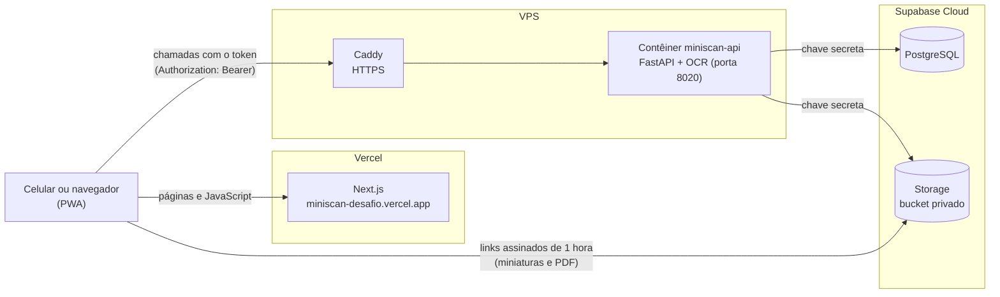

# Implantação do MiniScan

O MiniScan em produção tem três partes, cada uma num lugar:

| Parte | Onde roda | Endereço | O que faz |
|---|---|---|---|
| App (PWA) | Vercel | https://miniscan-desafio.vercel.app | Telas, câmera, recorte e editor. Fala só com a API. |
| API | VPS, em Docker | https://miniscan-api.duckdns.org | Login, cantos, filtros, OCR, PDF e histórico. Única parte que acessa o banco. |
| Banco e arquivos | Supabase Cloud | painel do Supabase | PostgreSQL (contas, sessões, documentos, páginas) e Storage (bucket privado `miniscan-files`). |



O navegador nunca recebe uma chave do Supabase. Ele busca as páginas na Vercel e conversa com a API, que confere a sessão, filtra os documentos pelo dono e devolve links temporários para os arquivos. O único acesso direto do navegador ao Supabase é a abertura desses links.

## Onde fica cada configuração

| Onde | Variável | Valor | Observação |
|---|---|---|---|
| Vercel (Settings → Environment Variables) | `NEXT_PUBLIC_API_URL` | `https://miniscan-api.duckdns.org` | Única variável do app. Entra no build: mudou, faça um novo deploy. |
| VPS, `/opt/miniscan/deploy/vps/.env` (permissão 600) | `SUPABASE_URL`, `SUPABASE_SERVICE_ROLE_KEY`, `MINISCAN_BUCKET` | do painel do Supabase | A chave secreta ignora o RLS. Nunca vai para o Git nem para a Vercel. |
| `deploy/vps/docker-compose.yml` (no Git) | `MINISCAN_ORIGENS_CORS`, `MINISCAN_ORIGENS_CORS_REGEX` | `localhost:3000` e o projeto `miniscan-desafio` da Vercel | Se o projeto da Vercel mudar de nome, ajuste aqui. |
| `deploy/vps/docker-compose.yml` (no Git) | `MINISCAN_THREADS_ONNX` | `1` | Igual ao `cpus` do contêiner. Sem isso, o OCR fica até 20 vezes mais lento com várias pessoas. |

Na Vercel, o projeto usa **Root Directory** `frontend` e **Framework Preset** `Next.js`, com os campos de Build, Output e Install sem Override.

## Como atualizar

Cada parte se atualiza de um jeito. Quando uma mudança mexe em mais de uma, a ordem é sempre **banco, depois API, depois app**: a API nova precisa encontrar as tabelas, e o app novo precisa encontrar as rotas.

### App (Vercel)

A Vercel publica sozinha a cada push no branch `main` do repositório ligado ao projeto (Settings → Git mostra qual é). O build leva cerca de um minuto. Depois, abra o app e confira o login.

Se o push foi para um repositório que não é o ligado ao projeto, o app não muda. Nesse caso, leve o commit para o repositório ligado, ou troque a ligação em Settings → Git.

### API (VPS)

Na VPS, um comando por vez:

```bash
cd /opt/miniscan && git pull
```
```bash
cd /opt/miniscan/deploy/vps && docker compose up -d --build
```
```bash
curl -s http://127.0.0.1:8020/saude
```
Depois de uns 30 segundos, tem que responder `"ocr_disponivel":true` e `"docaligner_disponivel":true`.
```bash
docker image prune -f --filter label=projeto=miniscan
```
Esse último apaga só as imagens antigas do MiniScan. A VPS tem outros projetos: nunca use `docker system prune`.

O build leva uns 3 minutos e usa os 2 núcleos da VPS nesse tempo. Evite o horário dos backups da VPS (meia-noite a 1h30 de Brasília). Se uma dependência Python mudou, regenere antes o `backend/requirements.txt` (veja `backend/README.md`), porque o Dockerfile instala por ele.

### Banco (migração nova)

1. Crie `supabase/migrations/<data><sequência>_<nome>.sql` e o `_down_` que desfaz, como as anteriores.
2. No painel do Supabase, SQL Editor → New query → cole o arquivo inteiro → Run.
3. Tabela nova já nasce fechada para a chave pública, porque a migração `20261118000004` tirou esse acesso padrão. Função nova, não: o PostgreSQL deixa qualquer papel executar. Feche com `REVOKE EXECUTE ON FUNCTION ... FROM PUBLIC, anon, authenticated;`, como na `20261118000004`. A API usa a chave secreta e não precisa de nenhuma concessão.

As migrações já aplicadas em produção vão até `20261118000004_adiciona_login.sql`.

## Conferir depois de um deploy

```bash
curl -s https://miniscan-api.duckdns.org/saude
```
Tem que ter `"status":"ok"` e os três `true`.
```bash
curl -s -o /dev/null -w "%{http_code}\n" -X POST https://miniscan-api.duckdns.org/detectar-cantos
```
Tem que dar `401`: sem login, a API recusa.
```bash
curl -s -o /dev/null -D - -H "Origin: https://miniscan-desafio.vercel.app" https://miniscan-api.duckdns.org/saude | grep -i access-control-allow-origin
```
Tem que devolver o endereço da Vercel. Sem essa linha, o navegador bloqueia as chamadas (CORS).

Depois disso, no celular, entre na conta, digitalize uma folha, salve e abra o documento pelo histórico.

## Quando algo dá errado

| O que aparece | Causa provável | O que fazer |
|---|---|---|
| Na Vercel, o build termina em 2 segundos e o site dá 404 em todas as páginas | Framework Preset ficou "Other" (só a pasta `public/` é publicada) | Settings → Build and Deployment → Framework Preset `Next.js`, salvar e fazer Redeploy |
| No app, "Não foi possível conectar ao servidor" em tudo | API fora do ar, ou CORS recusando o domínio do app | `/saude` da API; o teste de CORS acima; `docker logs miniscan-api --since 30m` na VPS |
| O app volta sozinho para a tela de entrada | A sessão venceu (30 dias) ou foi encerrada | Entrar de novo. Se acontecer com todo mundo, veja se a tabela `sessoes` existe |
| Erro 503 "As contas estão indisponíveis" | `.env` da VPS sem `SUPABASE_URL` ou sem a chave secreta | Conferir o `.env` e subir de novo com `docker compose up -d` |
| Erro 502 "O banco de dados não respondeu" | Supabase fora do ar, pausado ou com a chave trocada | Painel do Supabase; o detalhe aparece em `docker logs miniscan-api` |
| Miniaturas do histórico sem imagem | Os links assinados vencem em 1 hora | Recarregar a tela gera links novos |
| Push feito e o app continua igual | O projeto da Vercel está ligado a outro repositório | Settings → Git do projeto |
| OCR muito lento com várias pessoas | `MINISCAN_THREADS_ONNX` diferente dos núcleos do contêiner | Manter os dois iguais no compose |

## Voltar atrás

- **App:** na Vercel, Deployments → escolha o deploy anterior → ⋯ → Promote to Production. Volta na hora, sem build.
- **API:** na VPS, `cd /opt/miniscan && git checkout <commit>` e, em `deploy/vps`, `docker compose up -d --build`. Para voltar ao normal, `git checkout main && git pull`.
- **Banco:** cada migração tem um script `_down_`. O da `20261118000004` volta a deixar todos os documentos públicos e apaga as contas: não rode em produção com dados reais.

Para rodar tudo no computador, veja `backend/README.md` e `frontend/README.md`.
