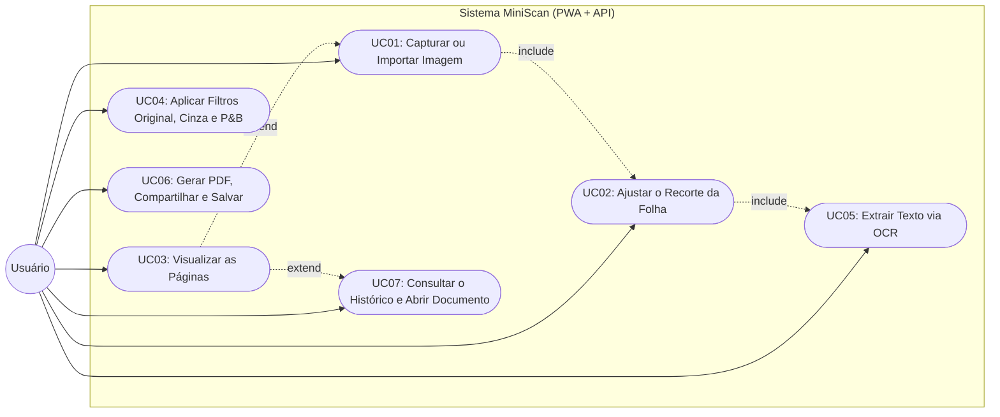
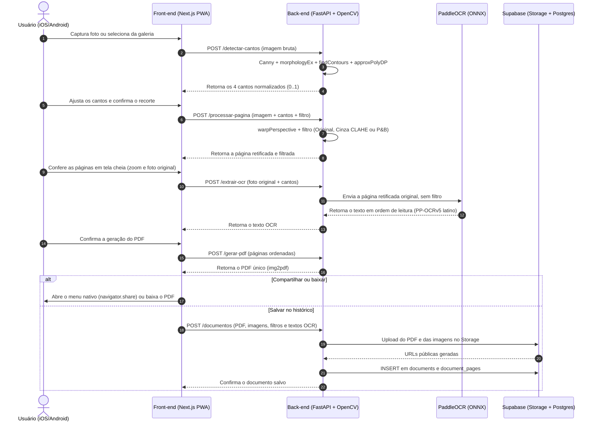
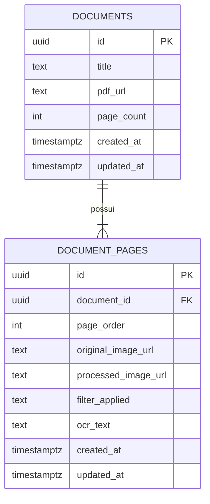

# DESAFIO MINISCAN - APLICATIVO DE DIGITALIZAÇÃO DE DOCUMENTOS

## 1. Introdução

Nesse trabalho o objetivo foi desenvolver um aplicativo de digitalização de documentos inspirado no CamScanner, rodando tanto no Android quanto no iPhone a partir de uma aplicação web instalável (PWA) feita em Next.js, integrada com uma API em Python (FastAPI) para o processamento de imagem e reconhecimento de texto (OCR), além do Supabase para salvar os arquivos e o histórico na nuvem. Dividi o projeto em duas camadas principais, a interface do usuário no front-end (Next.js e Tailwind CSS), onde ficam a captura pela câmera ou galeria, o ajuste manual dos pontos de corte, a visualização dos filtros e o compartilhamento do arquivo final, e o servidor no back-end (FastAPI, OpenCV, PaddleOCR em ONNX Runtime e img2pdf), que recebe a foto e faz todo o tratamento de visão computacional.

---

## 2. Especificação de Requisitos e Casos de Uso

### Requisitos Funcionais e Não Funcionais

Na definição do escopo, segui a lista do enunciado e acrescentei duas funções. O sistema precisa capturar ou selecionar imagens pela câmera ou pela galeria (RF01), visualizar as imagens capturadas em tela cheia, com zoom, troca de página e comparação entre a foto original e a página tratada, tanto durante a digitalização quanto nos documentos já salvos (RF02), aplicar e alternar entre os filtros original, escala de cinza e preto e branco (RF03), gerar um arquivo PDF único a partir das páginas digitalizadas (RF04) e salvar o documento no histórico na nuvem ou compartilhá-lo e baixá-lo pelo celular (RF05). O enunciado coloca o reconhecimento de texto como funcionalidade adicional, mas decidi tratá-lo como obrigatório, então o sistema também extrai o texto de cada página via OCR em português (RF06). Por fim, incluí a detecção automática das bordas da folha com correção de perspectiva, que deixa a página reta como num scanner e pode ser ajustada à mão (RF07). O modo de cartão de identidade, a captura automática ao vivo, o carimbo de data e hora no PDF e a busca pelo texto reconhecido são extras, descritos nas seções 3 e 4. Já nos requisitos não funcionais, a aplicação precisa rodar de forma instalável tanto no Android quanto no iPhone via navegador seguro com certificado SSL (RNF01), processar cada página em menos de 3 segundos em rede móvel comum (RNF02) e manter o servidor separado da interface através de uma API REST documentada (RNF03).

A tabela abaixo liga cada item do enunciado ao requisito, ao caso de uso e ao lugar do aplicativo onde ele aparece.

| Item do enunciado | Requisito | Caso de uso | Onde aparece no aplicativo |
|---|---|---|---|
| Capturar ou selecionar imagens de documentos | RF01 | UC01 | Câmera ao vivo (`/camera`) e galeria, no início e no editor |
| Visualizar as imagens capturadas | RF02 | UC03 | Visualizador em tela cheia, no editor, na revisão do lote e no documento salvo |
| Aplicar filtros (original, escala de cinza e preto e branco) | RF03 | UC04 | Editor (`/digitalizar/editor`) |
| Gerar arquivos PDF a partir das imagens | RF04 | UC06 | Exportação (`/digitalizar/exportar`) |
| Salvar ou compartilhar os documentos gerados | RF05 | UC06 e UC07 | Exportação, histórico (`/`) e documento salvo (`/documento`) |
| Reconhecimento de texto (adicional no enunciado) | RF06 | UC05 | Gaveta de texto do editor e documento salvo |
| Detecção de bordas e correção de perspectiva (extensão) | RF07 | UC02 | Câmera ao vivo e recorte (`/digitalizar/recorte`) |

### Casos de Uso do Sistema

O fluxo de interação conta apenas com o ator principal, o usuário final. Ele começa capturando uma foto ou escolhendo uma imagem da galeria (UC01) e confere o recorte da folha, com os quatro cantos detectados sozinhos e arrastáveis na tela (UC02); no modo lote e no cartão de identidade, o recorte detectado é aplicado direto e pode ser refeito depois pelo editor. Depois ele pode visualizar as páginas em tela cheia, ampliando para conferir se o texto ficou legível e comparando com a foto original (UC03); no modo lote, essa revisão também acontece antes do processamento, para excluir as fotos que saíram ruins. Em seguida escolhe o filtro de cada página (UC04) e confere o texto extraído pelo OCR, que roda sozinho depois de cada recorte, para copiar ou corrigir alguma palavra (UC05). Por fim, gera o PDF e o compartilha, baixa ou salva no histórico (UC06), onde pode buscar pelo título ou pelo texto e abrir o documento para ver de novo as páginas e o texto (UC07).

### Diagrama de Casos de Uso



---

## 3. Como os Métodos Funcionam (Pipeline de Visão Computacional)

Quando o usuário envia uma foto, o código primeiro redimensiona a imagem para acelerar o cálculo, aplica um filtro de suavização para tirar ruídos (GaussianBlur) e procura a folha por dois caminhos: pelo brilho, já que o papel costuma ser mais claro que a mesa (Canny e limiarização de Otsu), e pela cor, já que o papel é pouco saturado e uma mesa de madeira, ocre ou bege é mais saturada, mesmo quando as duas têm quase o mesmo brilho. Cada contorno encontrado vira um polígono de quatro pontas (convexHull e approxPolyDP); quando sobram mais lados, porque um dedo cobre um canto, a ponta da folha está dobrada ou o papel está ondulado, o programa prolonga os quatro lados mais longos até se cruzarem e recupera o canto que não aparece na foto. Entre os candidatos, vence o maior que tenha borda contínua nos quatro lados, medindo só o contraste perpendicular a cada lado, o que descarta o bloco de texto, e com um limiar que sobe em superfícies muito texturizadas para não inventar uma folha onde não existe. As coordenadas voltam para a tela caso o usuário precise ajustar os cantos na mão antes de confirmar.

Para deixar o documento reto como se tivesse sido escaneado de frente, a função de transformação de perspectiva (corrigir_perspectiva) ordena os quatro cantos escolhidos, calcula a matriz de homografia (getPerspectiveTransform) e faz o recorte ortogonal da folha (warpPerspective). Medir os lados da folha na foto não basta para saber a proporção da página: numa foto tirada inclinada, os lados mais longe da câmera encolhem, e a página sairia achatada, cerca de 14% a 20 graus e 24% a 30 graus. Por isso a proporção real é calculada pelo modelo da câmera (Zhang e He, 2007), assumindo a distância focal típica da câmera principal do celular; em fotos sintéticas o erro caiu para menos de 1%, e mesmo com outra lente, zoom ou foto recortada ele fica menor que o da medida pelos lados. Já na etapa dos filtros (aplicar_filtro), o modo original mantém as cores da foto corrigida, o modo escala de cinza usa equalização adaptativa de histograma (CLAHE) para equilibrar a luz da página e o modo preto e branco nivela a iluminação da página, dividindo-a por uma estimativa do papel sem a tinta, o que apaga sombras da mão ou do celular sobre o papel. Essa estimativa tem um piso de metade do brilho típico do papel: sem ele, uma área escura grande, como a foto 3x4 de um RG ou uma tarja preta de formulário, também era tomada por sombra e virava branco.

A extração de texto (extrair_texto_ocr), que o enunciado trata como funcionalidade adicional e eu coloquei no escopo obrigatório, usa o PaddleOCR com os modelos PP-OCRv5 latinos em ONNX, que cobrem o português com acentos. O OCR sempre lê a página retificada original, e não a versão em preto e branco: a rede neural do PaddleOCR se apoia nos gradientes suaves das bordas das letras, e a binarização transforma esses contornos em degraus, o que fazia a leitura cair de cerca de 99% para 35% quando o texto era pequeno na foto. Por isso o front-end envia a foto original junto com os cantos confirmados e a API retifica a página só para a leitura, enquanto o filtro preto e branco fica restrito ao que aparece na tela e no PDF. Nesse filtro, uma limiarização seca (adaptiveThreshold) deixava as letras quebradas e serrilhadas quando a página vinha de um quadro de vídeo do celular, em baixa resolução. Por isso a página pequena é ampliada antes, a iluminação é nivelada e, em vez de um corte seco, uma curva íngreme leva o papel para branco e a tinta para preto, mantendo tons intermediários só na borda das letras, como faz um scanner. O texto reconhecido é montado na ordem natural de leitura, de cima para baixo e da esquerda para a direita (ordenar_em_linhas), depois de desfazer a inclinação mediana das caixas de texto: numa página torta só 2 graus, o valor de uma tabela ia parar na linha de baixo.

A vantagem dessa arquitetura é que o OCR passou a rodar numa engine leve, o onnxruntime, sem depender de binários instalados no sistema operacional como o Tesseract e sem precisar do PyTorch no servidor, o que deixou a imagem Docker mais simples. A leitura também ficou mais robusta em fotos de celular com iluminação irregular: num teste com uma página com sombra forte, ruído e inclinação de 2,5 graus, o Tesseract leu 66% do texto da foto crua, enquanto o PaddleOCR leu 100%, incluindo todos os acentos. O custo é o tempo, cerca de 2,7 segundos por página no processador do meu computador, e por isso o front-end faz a leitura em segundo plano logo depois do recorte.

Por fim, o sistema junta todas as páginas processadas em um único arquivo PDF (gerar_pdf com img2pdf). Esse arquivo pode ser baixado ou enviado pelo menu nativo de compartilhamento do celular (navigator.share) direto do aparelho, e salvar no histórico é um passo à parte, que envia o PDF, as imagens e os textos para o armazenamento em nuvem (Supabase Storage) e para o banco.

### Câmera ao Vivo e Modos de Digitalização

Para a captura ficar parecida com a de um aplicativo nativo, a câmera do celular passou a fazer o recorte ao vivo. O mesmo pipeline de detecção de bordas do servidor (GaussianBlur, Canny, morphologyEx, findContours e approxPolyDP) roda no próprio navegador com o OpenCV.js, dentro de um Web Worker para não travar a interface, analisando uma versão reduzida de cada quadro do vídeo. O contorno encontrado é desenhado por cima da imagem da câmera e suavizado entre os quadros, e quando os quatro cantos ficam parados por cerca de 0,7 segundo a foto é tirada sozinha, já com os cantos detectados. No modo lote várias páginas são fotografadas em sequência, e a mesma folha não é fotografada de novo enquanto não sair do enquadramento. Antes de concluir, tocar na miniatura abre as fotos já tiradas em tela cheia, para excluir alguma que saiu tremida ou cortada sem gastar processamento com ela.

Além do modo de digitalização comum, criei um modo para documentos de identidade. Nele, a frente e o verso do documento são retificados e montados numa folha A4 no tamanho real do cartão (85,6 por 54 milímetros), como numa cópia autenticada. Há ainda a opção de carimbar a data e a hora em cada página do PDF. Cheguei a fazer modos para livro aberto, quadro branco, leitura de QR code e extração de texto direta, mas retirei os quatro: o enunciado pede um aplicativo simples, o texto de cada página já fica no editor, e o modo livro não corrigia a curvatura das páginas, então o resultado em livros de verdade ficava abaixo do resto do aplicativo.

### Visualização das Imagens Capturadas

Para atender ao item do enunciado de visualizar as imagens capturadas, criei um visualizador em tela cheia usado em três lugares: no editor, ao tocar na página; na revisão das fotos do modo lote; e na tela de um documento salvo, aberta a partir do histórico. Nele a página pode ser ampliada com o movimento de pinça ou com dois toques, e a parte ampliada pode ser arrastada para conferir se as letras pequenas ficaram legíveis. Deslizar para os lados troca de página, puxar para baixo fecha, e o gesto de voltar do celular também fecha o visualizador em vez de sair da tela. Um botão alterna entre a página tratada, já recortada e com o filtro, e a foto original como foi tirada, o que ajuda a perceber se o recorte deixou alguma parte da folha de fora. Usei a biblioteca yet-another-react-lightbox, que já resolve a diferença entre arrastar a página ampliada e deslizar para a próxima, a parte mais difícil de acertar no Safari do iPhone. Ela fica num arquivo à parte, baixado só pelas telas que usam o visualizador, para não pesar na abertura do aplicativo, e se esse download falhar o aplicativo avisa e segue funcionando, sem perder as páginas digitalizadas. O editor também mostra todas as páginas numa grade, e a tela do documento salvo reúne a grade das páginas, o texto reconhecido de cada uma, com a opção de copiar, e os botões para compartilhar, baixar e abrir o PDF.

### Diagrama de Sequência



---

## 4. Arquitetura do Banco de Dados (Supabase)

### Modelagem e Revisão Arquitetural

Para guardar os arquivos e permitir a pesquisa pelo texto lido dentro das imagens, estruturei o banco relacional (PostgreSQL no Supabase) com duas tabelas ligadas por chave estrangeira, a tabela de documentos (documents), que armazena o identificador único, o título, a data de criação, a data de atualização, a contagem automática de páginas e o link público do PDF gerado, e a tabela de páginas (document_pages), que guarda o vínculo com o documento pai, a ordem da página com restrição de unicidade, os links das imagens original e processada no armazenamento (Supabase Storage), o filtro escolhido e o texto extraído pelo OCR.

Na revisão de segurança e desempenho do banco, ativei a segurança em nível de linha (Row Level Security) em todas as tabelas e no armazenamento de arquivos, criei índices compostos para acelerar as consultas e exclusões em cascata, adicionei índices de busca textual em português (GIN com to_tsvector) para pesquisar documentos pelo conteúdo extraído no OCR, configurei gatilhos automáticos (Triggers) para atualizar o contador de páginas e a data de modificação, e limitei o armazenamento do bucket (miniscan-files) a arquivos de imagem e PDF de até 15 MB.

Na primeira versão do MVP, as políticas liberavam leitura, escrita e exclusão para o papel anônimo, o que permitia que qualquer pessoa com a chave pública do projeto alterasse ou apagasse o histórico. Para fechar essa brecha, concentrei todas as gravações na API, que usa a chave secreta do Supabase, e criei uma segunda migração (20261116000002_restringe_escrita_anonima.sql) que deixa o papel anônimo apenas com leitura nas tabelas e no Storage, além de revogar as permissões de escrita dessas tabelas. O bucket continua público para que os links de download funcionem. Por enquanto o histórico é o mesmo para todos que usam o aplicativo; a próxima evolução planejada é o login de usuário, com cadastro e senha guardada como hash, para que cada pessoa veja só os próprios documentos.

### Diagrama Entidade-Relacionamento (DER)



### Script SQL de Criação (Migração Principal)

Este script é a migração principal (20261116000001_init_miniscan_schema.sql). Execute-o completo no SQL Editor do Supabase para criar as tabelas, índices, gatilhos, políticas de segurança (RLS) e o bucket de armazenamento em uma única transação segura. Em seguida, rode as duas migrações seguintes da pasta supabase/migrations: a 20261116000002, que troca as políticas de acesso total do papel anônimo (as mvp_*_all_access abaixo) por políticas só de leitura, e a 20261116000003, que acrescenta o filtro de quadro branco (whiteboard) à restrição da coluna filter_applied; esse modo foi retirado depois, mas a migração continua na sequência.

```sql
BEGIN;

-- ============================================================================
-- FASE 1: TABELAS E RESTRIÇÕES DE INTEGRIDADE
-- ============================================================================

CREATE TABLE IF NOT EXISTS public.documents (
    id UUID DEFAULT gen_random_uuid() PRIMARY KEY,
    title TEXT NOT NULL CHECK (char_length(trim(title)) > 0),
    pdf_url TEXT,
    page_count INTEGER NOT NULL DEFAULT 0 CHECK (page_count >= 0),
    created_at TIMESTAMPTZ NOT NULL DEFAULT timezone('utc', now()),
    updated_at TIMESTAMPTZ NOT NULL DEFAULT timezone('utc', now())
);

CREATE TABLE IF NOT EXISTS public.document_pages (
    id UUID DEFAULT gen_random_uuid() PRIMARY KEY,
    document_id UUID NOT NULL REFERENCES public.documents(id) ON DELETE CASCADE,
    page_order INTEGER NOT NULL DEFAULT 1 CHECK (page_order > 0),
    original_image_url TEXT NOT NULL CHECK (char_length(trim(original_image_url)) > 0),
    processed_image_url TEXT NOT NULL CHECK (char_length(trim(processed_image_url)) > 0),
    filter_applied TEXT NOT NULL CHECK (filter_applied IN ('original', 'grayscale', 'bw')),
    ocr_text TEXT NOT NULL DEFAULT '',
    created_at TIMESTAMPTZ NOT NULL DEFAULT timezone('utc', now()),
    updated_at TIMESTAMPTZ NOT NULL DEFAULT timezone('utc', now()),
    CONSTRAINT uq_document_page_order UNIQUE (document_id, page_order)
);

-- ============================================================================
-- FASE 2: ÍNDICES E GATILHOS DE AUTOMAÇÃO (TRIGGERS)
-- ============================================================================

-- Índice para listar os documentos mais recentes na tela inicial
CREATE INDEX IF NOT EXISTS idx_documents_created_at 
    ON public.documents (created_at DESC);

-- Índice composto para otimizar junções de chave estrangeira e ordenação das páginas
CREATE INDEX IF NOT EXISTS idx_document_pages_doc_order 
    ON public.document_pages (document_id, page_order ASC);

-- Índices GIN para busca textual rápida (Full-Text Search) em português no título e OCR
CREATE INDEX IF NOT EXISTS idx_document_pages_ocr_fts 
    ON public.document_pages USING GIN (to_tsvector('portuguese', coalesce(ocr_text, '')));

CREATE INDEX IF NOT EXISTS idx_documents_title_fts 
    ON public.documents USING GIN (to_tsvector('portuguese', coalesce(title, '')));

-- Função de gatilho para atualizar automaticamente a coluna updated_at
CREATE OR REPLACE FUNCTION public.handle_updated_at()
RETURNS TRIGGER
LANGUAGE plpgsql
AS $$
BEGIN
    NEW.updated_at = timezone('utc', now());
    RETURN NEW;
END;
$$;

DROP TRIGGER IF EXISTS trg_documents_updated_at ON public.documents;
CREATE TRIGGER trg_documents_updated_at
    BEFORE UPDATE ON public.documents
    FOR EACH ROW
    EXECUTE FUNCTION public.handle_updated_at();

DROP TRIGGER IF EXISTS trg_document_pages_updated_at ON public.document_pages;
CREATE TRIGGER trg_document_pages_updated_at
    BEFORE UPDATE ON public.document_pages
    FOR EACH ROW
    EXECUTE FUNCTION public.handle_updated_at();

-- Função de gatilho para manter documents.page_count sincronizado automaticamente
CREATE OR REPLACE FUNCTION public.sync_document_page_count()
RETURNS TRIGGER
LANGUAGE plpgsql
AS $$
BEGIN
    IF TG_OP = 'INSERT' THEN
        UPDATE public.documents
        SET page_count = (SELECT count(*) FROM public.document_pages WHERE document_id = NEW.document_id)
        WHERE id = NEW.document_id;
        RETURN NEW;
    ELSIF TG_OP = 'DELETE' THEN
        UPDATE public.documents
        SET page_count = (SELECT count(*) FROM public.document_pages WHERE document_id = OLD.document_id)
        WHERE id = OLD.document_id;
        RETURN OLD;
    END IF;
    RETURN NULL;
END;
$$;

DROP TRIGGER IF EXISTS trg_sync_page_count ON public.document_pages;
CREATE TRIGGER trg_sync_page_count
    AFTER INSERT OR DELETE ON public.document_pages
    FOR EACH ROW
    EXECUTE FUNCTION public.sync_document_page_count();

-- Função RPC auxiliar para busca unificada pelo título do documento ou texto do OCR
CREATE OR REPLACE FUNCTION public.search_miniscan_documents(search_query TEXT)
RETURNS SETOF public.documents
LANGUAGE sql
STABLE
AS $$
    SELECT DISTINCT d.*
    FROM public.documents d
    LEFT JOIN public.document_pages dp ON dp.document_id = d.id
    WHERE 
        trim(search_query) = ''
        OR to_tsvector('portuguese', coalesce(d.title, '')) @@ plainto_tsquery('portuguese', search_query)
        OR to_tsvector('portuguese', coalesce(dp.ocr_text, '')) @@ plainto_tsquery('portuguese', search_query)
        OR d.title ILIKE '%' || search_query || '%'
        OR dp.ocr_text ILIKE '%' || search_query || '%'
    ORDER BY d.created_at DESC;
$$;

-- ============================================================================
-- FASE 3: SEGURANÇA EM NÍVEL DE LINHA (RLS) E BUCKET DE ARMAZENAMENTO
-- ============================================================================

ALTER TABLE public.documents ENABLE ROW LEVEL SECURITY;
ALTER TABLE public.document_pages ENABLE ROW LEVEL SECURITY;

-- Políticas explícitas por tabela (acesso liberado para o MVP sem barreira de login)
DROP POLICY IF EXISTS "mvp_documents_all_access" ON public.documents;
CREATE POLICY "mvp_documents_all_access"
    ON public.documents
    FOR ALL
    TO anon, authenticated
    USING (true)
    WITH CHECK (true);

DROP POLICY IF EXISTS "mvp_document_pages_all_access" ON public.document_pages;
CREATE POLICY "mvp_document_pages_all_access"
    ON public.document_pages
    FOR ALL
    TO anon, authenticated
    USING (true)
    WITH CHECK (true);

-- Configuração do Bucket no Storage (limite de 15 MB, restrito a imagens e PDFs)
INSERT INTO storage.buckets (id, name, public, file_size_limit, allowed_mime_types)
VALUES (
    'miniscan-files',
    'miniscan-files',
    true,
    15728640, -- 15 MB
    ARRAY['image/jpeg', 'image/png', 'image/webp', 'application/pdf']
)
ON CONFLICT (id) DO UPDATE SET
    public = EXCLUDED.public,
    file_size_limit = EXCLUDED.file_size_limit,
    allowed_mime_types = EXCLUDED.allowed_mime_types;

DROP POLICY IF EXISTS "mvp_storage_select" ON storage.objects;
CREATE POLICY "mvp_storage_select"
    ON storage.objects FOR SELECT
    TO anon, authenticated
    USING (bucket_id = 'miniscan-files');

DROP POLICY IF EXISTS "mvp_storage_insert" ON storage.objects;
CREATE POLICY "mvp_storage_insert"
    ON storage.objects FOR INSERT
    TO anon, authenticated
    WITH CHECK (bucket_id = 'miniscan-files');

DROP POLICY IF EXISTS "mvp_storage_update" ON storage.objects;
CREATE POLICY "mvp_storage_update"
    ON storage.objects FOR UPDATE
    TO anon, authenticated
    USING (bucket_id = 'miniscan-files')
    WITH CHECK (bucket_id = 'miniscan-files');

DROP POLICY IF EXISTS "mvp_storage_delete" ON storage.objects;
CREATE POLICY "mvp_storage_delete"
    ON storage.objects FOR DELETE
    TO anon, authenticated
    USING (bucket_id = 'miniscan-files');

COMMIT;
```

### Script SQL de Reversão (Rollback)

Mantenha este script salvo na pasta de migrações para demonstrar reversibilidade segura do banco de dados:

```sql
BEGIN;

DROP POLICY IF EXISTS "mvp_storage_delete" ON storage.objects;
DROP POLICY IF EXISTS "mvp_storage_update" ON storage.objects;
DROP POLICY IF EXISTS "mvp_storage_insert" ON storage.objects;
DROP POLICY IF EXISTS "mvp_storage_select" ON storage.objects;

DROP FUNCTION IF EXISTS public.search_miniscan_documents(TEXT);
DROP TRIGGER IF EXISTS trg_sync_page_count ON public.document_pages;
DROP FUNCTION IF EXISTS public.sync_document_page_count();
DROP TRIGGER IF EXISTS trg_document_pages_updated_at ON public.document_pages;
DROP TRIGGER IF EXISTS trg_documents_updated_at ON public.documents;
DROP FUNCTION IF EXISTS public.handle_updated_at();

DROP TABLE IF EXISTS public.document_pages;
DROP TABLE IF EXISTS public.documents;

COMMIT;
```

### Script SQL de Validação e Testes

Execute este bloco após rodar a migração principal para validar as restrições, gatilhos e busca textual em português (o comando `ROLLBACK` ao final garante que nenhum dado de teste fique sujando o banco):

```sql
BEGIN;

-- Teste 1: Inserir documento e 2 páginas, validando a atualização automática de page_count
WITH novo_doc AS (
    INSERT INTO public.documents (title, pdf_url)
    VALUES ('Contrato Estágio UTFPR', 'https://exemplo.com/contrato.pdf')
    RETURNING id
)
INSERT INTO public.document_pages (document_id, page_order, original_image_url, processed_image_url, filter_applied, ocr_text)
SELECT id, 1, 'https://exemplo.com/p1_orig.jpg', 'https://exemplo.com/p1_bw.jpg', 'bw', 'Termo de compromisso de iniciação científica em visão computacional'
FROM novo_doc
UNION ALL
SELECT id, 2, 'https://exemplo.com/p2_orig.jpg', 'https://exemplo.com/p2_bw.jpg', 'grayscale', 'Assinatura do orientador e coordenador do curso'
FROM novo_doc;

-- Resultado esperado: page_count = 2
SELECT title, page_count FROM public.documents WHERE title = 'Contrato Estágio UTFPR';

-- Teste 2: Validar busca textual em português (radicalização de palavras)
-- Resultado esperado: 1 linha. Sem o acento ('iniciacao'), a busca ainda não encontra.
SELECT id, title, page_count FROM public.search_miniscan_documents('iniciação');

-- Teste 3: Validar exclusão em cascata das páginas filhas
DELETE FROM public.documents WHERE title = 'Contrato Estágio UTFPR';
SELECT count(*) AS paginas_orfas FROM public.document_pages; -- Resultado esperado: 0

ROLLBACK;
```

---

## 5. Prototipação de Interface (Estrutura das Telas no Figma)

Para o esqueleto visual no Figma (frame mobile 390 x 844 px), o fluxo foi estruturado em quatro telas conectadas:

1. **Tela 1 - Início e Histórico:** Cabeçalho com o título MiniScan, barra de busca textual (conectada à função search_miniscan_documents), lista de cartões com miniatura da primeira página, data e contagem de folhas, além do botão inferior para acionar a câmera ou a galeria.
2. **Tela 2 - Ajuste de Perspectiva (Recorte):** Exibição da foto capturada com o polígono conectando os quatro vértices arrastáveis detectados pela API e o botão de confirmação do recorte.
3. **Tela 3 - Editor de Filtros e Gaveta de OCR:** Visualização da folha retificada com seletor inferior para alternar entre os modos Original, Escala de Cinza e Preto e Branco, botão para abrir o modal com o texto extraído pelo OCR e opção para adicionar novas páginas ao mesmo PDF.
4. **Tela 4 - Exportação e Compartilhamento:** Campo para editar o nome do arquivo final e botões principais para compartilhar o PDF pelo menu nativo do celular (navigator.share) ou baixar o documento.

Depois do protótipo, duas telas entraram no aplicativo para cobrir a visualização das imagens: o visualizador de páginas, em tela cheia, com zoom e a troca entre a foto original e a página tratada, e a tela do documento salvo, aberta pelo histórico, com a grade das páginas, o texto reconhecido e os botões do PDF.

---

## 6. Desafios e Dificuldades

A parte que deu mais trabalho foi fazer a detecção automática das bordas funcionar quando o documento branco estava em cima de uma mesa clara ou com pouca luz, porque o algoritmo de bordas (Canny) acabava se perdendo e não fechava os quatro cantos da folha. Consegui resolver isso adicionando um fechamento morfológico (morphologyEx) antes de buscar os contornos e deixando o usuário arrastar os quatro vértices na tela do celular sempre que o fundo tiver pouco contraste. Na hora de rodar no iPhone também tive que ter cuidado com o acesso à câmera e o compartilhamento do arquivo pelo Safari. A câmera ao vivo (getUserMedia) só funciona com o aplicativo aberto por HTTPS, então testei no celular por um túnel HTTPS e deixei o seletor nativo de captura do navegador como alternativa quando a câmera ao vivo não está disponível. O menu de compartilhar do iPhone também só abre logo depois do toque, por isso o PDF já fica pronto na memória antes de a pessoa tocar em compartilhar. O manifesto da aplicação, gerado em src/app/manifest.ts, permite instalar o MiniScan na tela de início.

Outra dificuldade que apareceu na parte de leitura de texto foi o desempenho baixo do Tesseract nas fotos tiradas com a câmera do celular, porque ele falhava quando a folha tinha alguma inclinação, sombra ou quando existiam fotos e carimbos no meio da página que geravam caracteres errados no resultado. Consegui resolver isso trocando o motor de OCR pelo PaddleOCR (via biblioteca rapidocr), que usa redes neurais para detectar e alinhar as linhas de texto antes de ler. Também cheguei a combinar o pipeline com o modelo DocLayout-YOLO em ONNX para identificar onde estavam as figuras da página e mantê-las originais no PDF, mas num teste com um RG ele classificou o documento inteiro como figura por causa da foto 3x4, e ainda deixava o servidor bem mais pesado. Sem ele, o pico de memória da API caiu de cerca de 1 GB para 400 MB, o filtro preto e branco passou de 2,4 segundos para menos de um décimo de segundo e o OCR de 4,9 para 2,7 segundos por página, então decidi retirar essa parte e manter o sistema mais leve e previsível.

Algumas limitações ainda estão em aberto. O histórico é o mesmo para todos que usam o aplicativo, porque ainda não há login, e não dá para excluir um documento salvo pelo próprio aplicativo. As páginas de uma digitalização em andamento ficam só na memória do navegador, então recarregar a página no meio do processo descarta o que não foi salvo. A busca não encontra uma palavra digitada sem acento quando o texto do documento tem acento, o que pode ser resolvido com a extensão unaccent do PostgreSQL. Por fim, a detecção de bordas e o filtro preto e branco foram calibrados com fotos sintéticas, e ainda falta medir o acerto com um conjunto de fotos reais tiradas no celular.