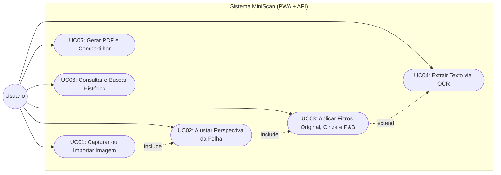
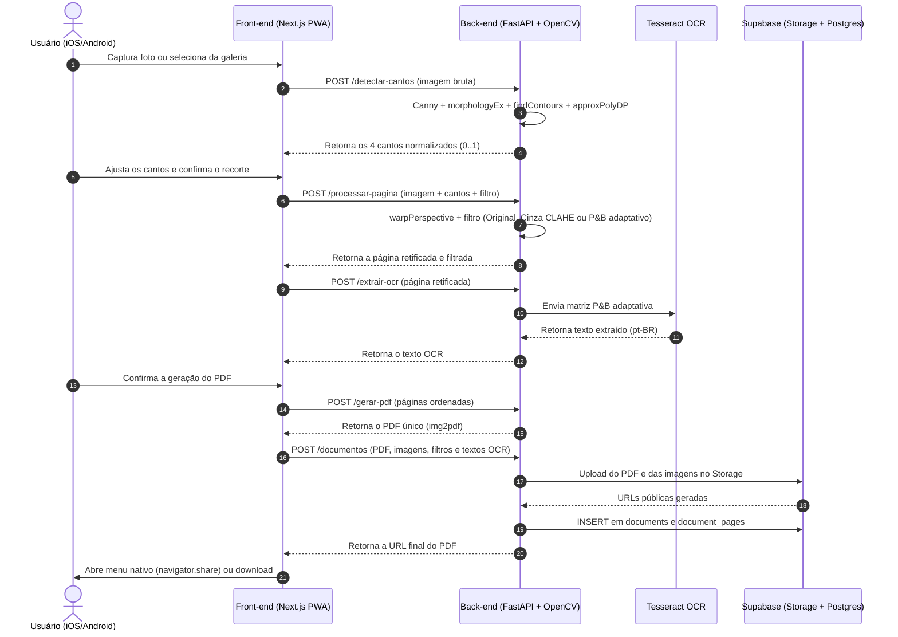
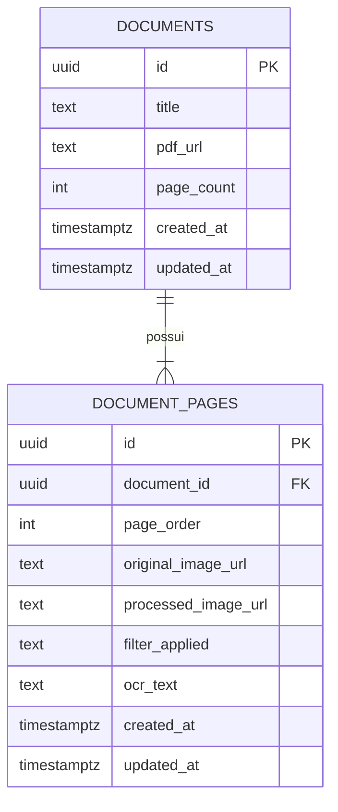

# DESAFIO MINISCAN - APLICATIVO DE DIGITALIZAÇÃO DE DOCUMENTOS

## 1. Introdução

Nesse trabalho o objetivo foi desenvolver um aplicativo de digitalização de documentos inspirado no CamScanner, rodando tanto no Android quanto no iPhone a partir de uma aplicação web instalável (PWA) feita em Next.js, integrada com uma API em Python (FastAPI) para o processamento de imagem e reconhecimento de texto (OCR), além do Supabase para salvar os arquivos e o histórico na nuvem. Dividi o projeto em duas camadas principais, a interface do usuário no front-end (Next.js e Tailwind CSS), onde ficam a captura pela câmera ou galeria, o ajuste manual dos pontos de corte, a visualização dos filtros e o compartilhamento do arquivo final, e o servidor no back-end (FastAPI, OpenCV, Tesseract e img2pdf), que recebe a foto e faz todo o tratamento de visão computacional.

---

## 2. Especificação de Requisitos e Casos de Uso

### Requisitos Funcionais e Não Funcionais

Na definição do escopo, o sistema precisa atender a seis requisitos funcionais principais, capturar ou selecionar imagens pela câmera ou galeria (RF01), detectar as bordas da folha e corrigir a perspectiva (RF02), aplicar e alternar entre os filtros original, escala de cinza e preto e branco (RF03), extrair o texto da imagem via reconhecimento óptico de caracteres (RF04), gerar um arquivo PDF único a partir das páginas digitalizadas (RF05) e salvar o histórico na nuvem com opção de baixar ou compartilhar o arquivo (RF06). Já nos requisitos não funcionais, a aplicação precisa rodar de forma instalável tanto no Android quanto no iPhone via navegador seguro com certificado SSL (RNF01), processar cada página em menos de 3 segundos em rede móvel comum (RNF02) e manter o servidor separado da interface através de uma API REST documentada (RNF03).

### Casos de Uso do Sistema

O fluxo de interação conta apenas com o ator principal, o usuário final, que inicia o uso no caso de uso de digitalizar documento (UC01), onde ele tira uma foto ou escolhe uma imagem da galeria e ajusta os quatro cantos da folha na tela. Na sequência, o usuário entra no caso de uso de tratar e revisar página (UC02), alternando entre os filtros de imagem e conferindo o texto extraído pelo OCR para copiar ou corrigir alguma palavra. Por fim, no caso de uso de exportar e gerenciar histórico (UC03), o usuário gera o arquivo PDF final, aciona o menu de compartilhamento do celular ou salva o registro no banco de dados para consultar depois pela barra de busca textual.

### Diagrama de Casos de Uso



---

## 3. Como os Métodos Funcionam (Pipeline de Visão Computacional)

Quando o usuário envia uma foto, o código primeiro redimensiona a imagem para acelerar o cálculo, converte para tons de cinza (cvtColor), aplica um filtro de suavização para tirar ruídos (GaussianBlur) e detecta as bordas da folha (Canny). Com as bordas marcadas, o programa procura os maiores contornos fechados (findContours) e aproxima o formato para um polígono de quatro pontas (approxPolyDP), devolvendo essas coordenadas para a tela caso o usuário precise ajustar os cantos na mão antes de confirmar.

Para deixar o documento reto como se tivesse sido escaneado de frente, a função de transformação de perspectiva (corrigir_perspectiva) ordena os quatro cantos escolhidos, calcula a matriz de homografia (getPerspectiveTransform) e faz o recorte ortogonal da folha (warpPerspective). Já na etapa dos filtros (aplicar_filtro), o modo original mantém as cores da foto corrigida, o modo escala de cinza usa equalização adaptativa de histograma (CLAHE) para equilibrar a luz da página e o modo preto e branco aplica uma limiarização adaptativa (adaptiveThreshold), que calcula o contraste por pequenos blocos de pixels e apaga sombras da mão ou do celular sobre o papel.

Como extra, implementei a extração de texto (extrair_texto_ocr) passando a imagem já limpa pelo filtro preto e branco para o motor de reconhecimento óptico (pytesseract configurado em português), porque tirar as sombras antes melhora bastante a leitura das letras. Por fim, o sistema junta todas as páginas processadas em um único arquivo PDF (gerar_pdf com img2pdf), envia o arquivo para o armazenamento em nuvem (Supabase Storage) e libera o download ou o menu nativo de compartilhamento do celular (navigator.share).

### Diagrama de Sequência



---

## 4. Arquitetura do Banco de Dados (Supabase)

### Modelagem e Revisão Arquitetural

Para guardar os arquivos e permitir a pesquisa pelo texto lido dentro das imagens, estruturei o banco relacional (PostgreSQL no Supabase) com duas tabelas ligadas por chave estrangeira, a tabela de documentos (documents), que armazena o identificador único, o título, a data de criação, a data de atualização, a contagem automática de páginas e o link público do PDF gerado, e a tabela de páginas (document_pages), que guarda o vínculo com o documento pai, a ordem da página com restrição de unicidade, os links das imagens original e processada no armazenamento (Supabase Storage), o filtro escolhido e o texto extraído pelo OCR.

Na revisão de segurança e desempenho do banco, ativei a segurança em nível de linha (Row Level Security) em todas as tabelas e no armazenamento de arquivos, criei índices compostos para acelerar as consultas e exclusões em cascata, adicionei índices de busca textual em português (GIN com to_tsvector) para pesquisar documentos pelo conteúdo extraído no OCR, configurei gatilhos automáticos (Triggers) para atualizar o contador de páginas e a data de modificação, e limitei o armazenamento do bucket (miniscan-files) a arquivos de imagem e PDF de até 15 MB.

Na primeira versão do MVP, as políticas liberavam leitura, escrita e exclusão para o papel anônimo, o que permitia que qualquer pessoa com a chave pública do projeto alterasse ou apagasse o histórico. Para fechar essa brecha, concentrei todas as gravações na API, que usa a chave secreta do Supabase, e criei uma segunda migração (20261116000002_restringe_escrita_anonima.sql) que deixa o papel anônimo apenas com leitura nas tabelas e no Storage, além de revogar as permissões de escrita dessas tabelas. O bucket continua público para que os links de download funcionem. A próxima evolução é adotar o login anônimo do Supabase para separar o histórico de cada aparelho.

### Diagrama Entidade-Relacionamento (DER)



### Script SQL de Criação (Migração Principal)

Execute este script completo no SQL Editor do Supabase para criar as tabelas, índices, gatilhos, políticas de segurança (RLS) e o bucket de armazenamento em uma única transação segura:

```sql
BEGIN;

-- ============================================================================
-- FASE 1: TABELAS E RESTRIÇÕES DE INTEGRIDADE
-- ============================================================================

CREATE TABLE IF NOT EXISTS public.documents (
    id UUID DEFAULT gen_random_uuid() PRIMARY KEY,
    title TEXT NOT NULL CHECK (char_length(trim(title)) > 0),
    pdf_url TEXT,
    page_count INTEGER NOT NULL DEFAULT 0 CHECK (page_count >= 0),
    created_at TIMESTAMPTZ NOT NULL DEFAULT timezone('utc', now()),
    updated_at TIMESTAMPTZ NOT NULL DEFAULT timezone('utc', now())
);

CREATE TABLE IF NOT EXISTS public.document_pages (
    id UUID DEFAULT gen_random_uuid() PRIMARY KEY,
    document_id UUID NOT NULL REFERENCES public.documents(id) ON DELETE CASCADE,
    page_order INTEGER NOT NULL DEFAULT 1 CHECK (page_order > 0),
    original_image_url TEXT NOT NULL CHECK (char_length(trim(original_image_url)) > 0),
    processed_image_url TEXT NOT NULL CHECK (char_length(trim(processed_image_url)) > 0),
    filter_applied TEXT NOT NULL CHECK (filter_applied IN ('original', 'grayscale', 'bw')),
    ocr_text TEXT NOT NULL DEFAULT '',
    created_at TIMESTAMPTZ NOT NULL DEFAULT timezone('utc', now()),
    updated_at TIMESTAMPTZ NOT NULL DEFAULT timezone('utc', now()),
    CONSTRAINT uq_document_page_order UNIQUE (document_id, page_order)
);

-- ============================================================================
-- FASE 2: ÍNDICES E GATILHOS DE AUTOMAÇÃO (TRIGGERS)
-- ============================================================================

-- Índice para listar os documentos mais recentes na tela inicial
CREATE INDEX IF NOT EXISTS idx_documents_created_at 
    ON public.documents (created_at DESC);

-- Índice composto para otimizar junções de chave estrangeira e ordenação das páginas
CREATE INDEX IF NOT EXISTS idx_document_pages_doc_order 
    ON public.document_pages (document_id, page_order ASC);

-- Índices GIN para busca textual rápida (Full-Text Search) em português no título e OCR
CREATE INDEX IF NOT EXISTS idx_document_pages_ocr_fts 
    ON public.document_pages USING GIN (to_tsvector('portuguese', coalesce(ocr_text, '')));

CREATE INDEX IF NOT EXISTS idx_documents_title_fts 
    ON public.documents USING GIN (to_tsvector('portuguese', coalesce(title, '')));

-- Função de gatilho para atualizar automaticamente a coluna updated_at
CREATE OR REPLACE FUNCTION public.handle_updated_at()
RETURNS TRIGGER
LANGUAGE plpgsql
AS $$
BEGIN
    NEW.updated_at = timezone('utc', now());
    RETURN NEW;
END;
$$;

DROP TRIGGER IF EXISTS trg_documents_updated_at ON public.documents;
CREATE TRIGGER trg_documents_updated_at
    BEFORE UPDATE ON public.documents
    FOR EACH ROW
    EXECUTE FUNCTION public.handle_updated_at();

DROP TRIGGER IF EXISTS trg_document_pages_updated_at ON public.document_pages;
CREATE TRIGGER trg_document_pages_updated_at
    BEFORE UPDATE ON public.document_pages
    FOR EACH ROW
    EXECUTE FUNCTION public.handle_updated_at();

-- Função de gatilho para manter documents.page_count sincronizado automaticamente
CREATE OR REPLACE FUNCTION public.sync_document_page_count()
RETURNS TRIGGER
LANGUAGE plpgsql
AS $$
BEGIN
    IF TG_OP = 'INSERT' THEN
        UPDATE public.documents
        SET page_count = (SELECT count(*) FROM public.document_pages WHERE document_id = NEW.document_id)
        WHERE id = NEW.document_id;
        RETURN NEW;
    ELSIF TG_OP = 'DELETE' THEN
        UPDATE public.documents
        SET page_count = (SELECT count(*) FROM public.document_pages WHERE document_id = OLD.document_id)
        WHERE id = OLD.document_id;
        RETURN OLD;
    END IF;
    RETURN NULL;
END;
$$;

DROP TRIGGER IF EXISTS trg_sync_page_count ON public.document_pages;
CREATE TRIGGER trg_sync_page_count
    AFTER INSERT OR DELETE ON public.document_pages
    FOR EACH ROW
    EXECUTE FUNCTION public.sync_document_page_count();

-- Função RPC auxiliar para busca unificada pelo título do documento ou texto do OCR
CREATE OR REPLACE FUNCTION public.search_miniscan_documents(search_query TEXT)
RETURNS SETOF public.documents
LANGUAGE sql
STABLE
AS $$
    SELECT DISTINCT d.*
    FROM public.documents d
    LEFT JOIN public.document_pages dp ON dp.document_id = d.id
    WHERE 
        trim(search_query) = ''
        OR to_tsvector('portuguese', coalesce(d.title, '')) @@ plainto_tsquery('portuguese', search_query)
        OR to_tsvector('portuguese', coalesce(dp.ocr_text, '')) @@ plainto_tsquery('portuguese', search_query)
        OR d.title ILIKE '%' || search_query || '%'
        OR dp.ocr_text ILIKE '%' || search_query || '%'
    ORDER BY d.created_at DESC;
$$;

-- ============================================================================
-- FASE 3: SEGURANÇA EM NÍVEL DE LINHA (RLS) E BUCKET DE ARMAZENAMENTO
-- ============================================================================

ALTER TABLE public.documents ENABLE ROW LEVEL SECURITY;
ALTER TABLE public.document_pages ENABLE ROW LEVEL SECURITY;

-- Políticas explícitas por tabela (acesso liberado para o MVP sem barreira de login)
DROP POLICY IF EXISTS "mvp_documents_all_access" ON public.documents;
CREATE POLICY "mvp_documents_all_access"
    ON public.documents
    FOR ALL
    TO anon, authenticated
    USING (true)
    WITH CHECK (true);

DROP POLICY IF EXISTS "mvp_document_pages_all_access" ON public.document_pages;
CREATE POLICY "mvp_document_pages_all_access"
    ON public.document_pages
    FOR ALL
    TO anon, authenticated
    USING (true)
    WITH CHECK (true);

-- Configuração do Bucket no Storage (limite de 15 MB, restrito a imagens e PDFs)
INSERT INTO storage.buckets (id, name, public, file_size_limit, allowed_mime_types)
VALUES (
    'miniscan-files',
    'miniscan-files',
    true,
    15728640, -- 15 MB
    ARRAY['image/jpeg', 'image/png', 'image/webp', 'application/pdf']
)
ON CONFLICT (id) DO UPDATE SET
    public = EXCLUDED.public,
    file_size_limit = EXCLUDED.file_size_limit,
    allowed_mime_types = EXCLUDED.allowed_mime_types;

DROP POLICY IF EXISTS "mvp_storage_select" ON storage.objects;
CREATE POLICY "mvp_storage_select"
    ON storage.objects FOR SELECT
    TO anon, authenticated
    USING (bucket_id = 'miniscan-files');

DROP POLICY IF EXISTS "mvp_storage_insert" ON storage.objects;
CREATE POLICY "mvp_storage_insert"
    ON storage.objects FOR INSERT
    TO anon, authenticated
    WITH CHECK (bucket_id = 'miniscan-files');

DROP POLICY IF EXISTS "mvp_storage_update" ON storage.objects;
CREATE POLICY "mvp_storage_update"
    ON storage.objects FOR UPDATE
    TO anon, authenticated
    USING (bucket_id = 'miniscan-files')
    WITH CHECK (bucket_id = 'miniscan-files');

DROP POLICY IF EXISTS "mvp_storage_delete" ON storage.objects;
CREATE POLICY "mvp_storage_delete"
    ON storage.objects FOR DELETE
    TO anon, authenticated
    USING (bucket_id = 'miniscan-files');

COMMIT;
```

### Script SQL de Reversão (Rollback)

Mantenha este script salvo na pasta de migrações para demonstrar reversibilidade segura do banco de dados:

```sql
BEGIN;

DROP POLICY IF EXISTS "mvp_storage_delete" ON storage.objects;
DROP POLICY IF EXISTS "mvp_storage_update" ON storage.objects;
DROP POLICY IF EXISTS "mvp_storage_insert" ON storage.objects;
DROP POLICY IF EXISTS "mvp_storage_select" ON storage.objects;

DROP FUNCTION IF EXISTS public.search_miniscan_documents(TEXT);
DROP TRIGGER IF EXISTS trg_sync_page_count ON public.document_pages;
DROP FUNCTION IF EXISTS public.sync_document_page_count();
DROP TRIGGER IF EXISTS trg_document_pages_updated_at ON public.document_pages;
DROP TRIGGER IF EXISTS trg_documents_updated_at ON public.documents;
DROP FUNCTION IF EXISTS public.handle_updated_at();

DROP TABLE IF EXISTS public.document_pages;
DROP TABLE IF EXISTS public.documents;

COMMIT;
```

### Script SQL de Validação e Testes

Execute este bloco após rodar a migração principal para validar as restrições, gatilhos e busca textual em português (o comando `ROLLBACK` ao final garante que nenhum dado de teste fique sujando o banco):

```sql
BEGIN;

-- Teste 1: Inserir documento e 2 páginas, validando a atualização automática de page_count
WITH novo_doc AS (
    INSERT INTO public.documents (title, pdf_url)
    VALUES ('Contrato Estágio UTFPR', 'https://exemplo.com/contrato.pdf')
    RETURNING id
)
INSERT INTO public.document_pages (document_id, page_order, original_image_url, processed_image_url, filter_applied, ocr_text)
SELECT id, 1, 'https://exemplo.com/p1_orig.jpg', 'https://exemplo.com/p1_bw.jpg', 'bw', 'Termo de compromisso de iniciação científica em visão computacional'
FROM novo_doc
UNION ALL
SELECT id, 2, 'https://exemplo.com/p2_orig.jpg', 'https://exemplo.com/p2_bw.jpg', 'grayscale', 'Assinatura do orientador e coordenador do curso'
FROM novo_doc;

-- Resultado esperado: page_count = 2
SELECT title, page_count FROM public.documents WHERE title = 'Contrato Estágio UTFPR';

-- Teste 2: Validar busca textual em português (radicalização de palavras)
SELECT id, title, page_count FROM public.search_miniscan_documents('iniciacao');

-- Teste 3: Validar exclusão em cascata das páginas filhas
DELETE FROM public.documents WHERE title = 'Contrato Estágio UTFPR';
SELECT count(*) AS paginas_orfas FROM public.document_pages; -- Resultado esperado: 0

ROLLBACK;
```

---

## 5. Prototipação de Interface (Estrutura das Telas no Figma)

Para o esqueleto visual no Figma (frame mobile 390 x 844 px), o fluxo foi estruturado em quatro telas conectadas:

1. **Tela 1 - Início e Histórico:** Cabeçalho com o título MiniScan, barra de busca textual (conectada à função search_miniscan_documents), lista de cartões com miniatura da primeira página, data e contagem de folhas, além do botão inferior para acionar a câmera ou a galeria.
2. **Tela 2 - Ajuste de Perspectiva (Recorte):** Exibição da foto capturada com o polígono conectando os quatro vértices arrastáveis detectados pela API e o botão de confirmação do recorte.
3. **Tela 3 - Editor de Filtros e Gaveta de OCR:** Visualização da folha retificada com seletor inferior para alternar entre os modos Original, Escala de Cinza e Preto e Branco, botão para abrir o modal com o texto extraído pelo OCR e opção para adicionar novas páginas ao mesmo PDF.
4. **Tela 4 - Exportação e Compartilhamento:** Campo para editar o nome do arquivo final e botões principais para compartilhar o PDF pelo menu nativo do celular (navigator.share) ou baixar o documento.

---

## 6. Desafios e Dificuldades

A parte que deu mais trabalho foi fazer a detecção automática das bordas funcionar quando o documento branco estava em cima de uma mesa clara ou com pouca luz, porque o algoritmo de bordas (Canny) acabava se perdendo e não fechava os quatro cantos da folha. Consegui resolver isso adicionando um fechamento morfológico (morphologyEx) antes de buscar os contornos e deixando o usuário arrastar os quatro vértices na tela do celular sempre que o fundo tiver pouco contraste. Na hora de rodar no iPhone também tive que ter cuidado com o acesso à câmera e o compartilhamento do arquivo pelo Safari, ajustando o manifesto da aplicação (manifest.json) e usando o seletor nativo de captura de mídia no navegador para evitar bloqueios de permissão no iOS.