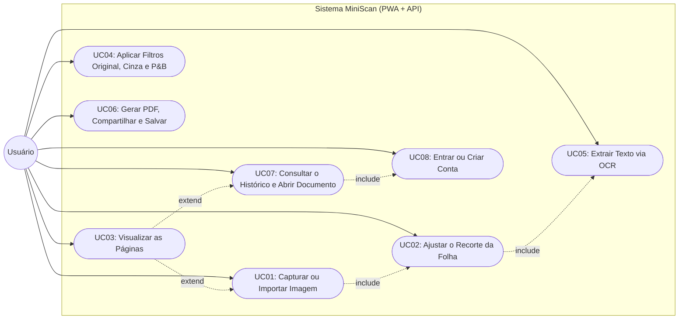
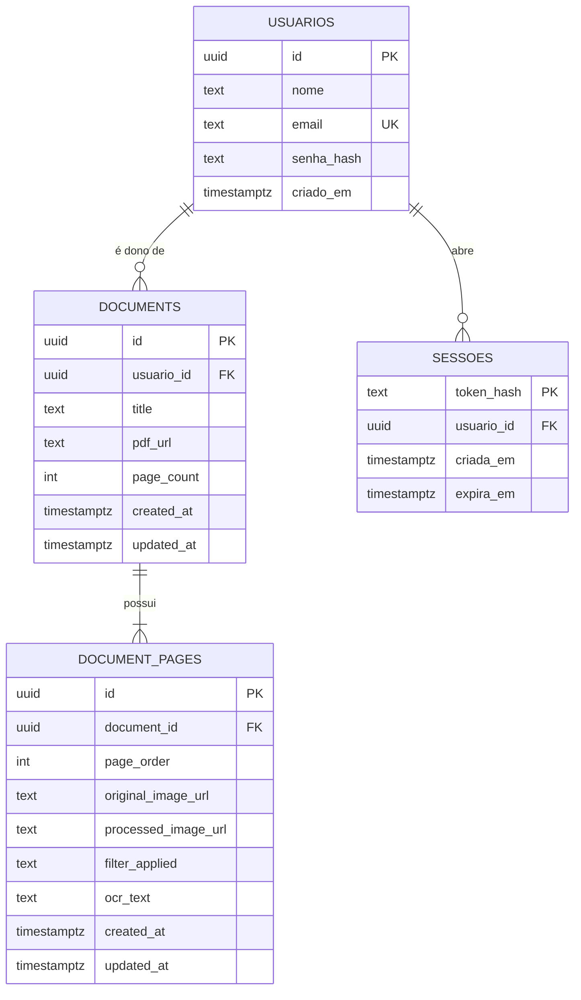
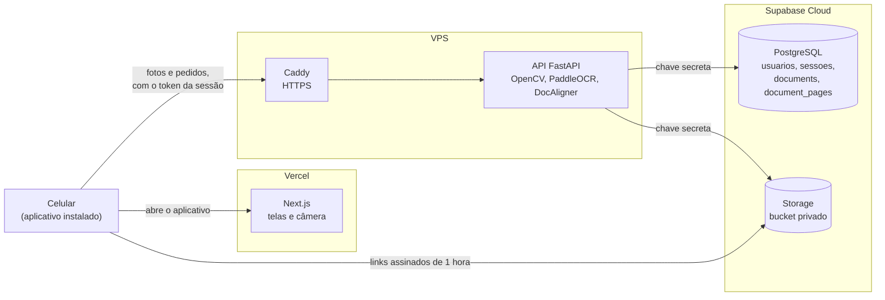

# DESAFIO MINISCAN - APLICATIVO DE DIGITALIZAÇÃO DE DOCUMENTOS

## 1. Introdução

Nesse trabalho o objetivo foi desenvolver um aplicativo de digitalização de documentos inspirado no CamScanner, rodando tanto no Android quanto no iPhone a partir de uma aplicação web instalável (PWA) feita em Next.js, integrada com uma API em Python (FastAPI) para o processamento de imagem e reconhecimento de texto (OCR), além do Supabase para salvar os arquivos e o histórico na nuvem. Dividi o projeto em duas camadas principais, a interface do usuário no front-end (Next.js e Tailwind CSS), onde ficam a captura pela câmera ou galeria, o ajuste manual dos pontos de corte, a visualização dos filtros e o compartilhamento do arquivo final, e o servidor no back-end (FastAPI, OpenCV, PaddleOCR em ONNX Runtime e img2pdf), que recebe a foto e faz todo o tratamento de visão computacional.

---

## 2. Especificação de Requisitos e Casos de Uso

### Requisitos Funcionais e Não Funcionais

Na definição do escopo, segui a lista do enunciado e acrescentei duas funções. O sistema precisa capturar ou selecionar imagens pela câmera ou pela galeria (RF01), visualizar as imagens capturadas em tela cheia, com zoom, troca de página e comparação entre a foto original e a página tratada, tanto durante a digitalização quanto nos documentos já salvos (RF02), aplicar e alternar entre os filtros original, escala de cinza e preto e branco (RF03), gerar um arquivo PDF único a partir das páginas digitalizadas (RF04) e salvar o documento no histórico na nuvem ou compartilhá-lo e baixá-lo pelo celular (RF05). O enunciado coloca o reconhecimento de texto como funcionalidade adicional, mas decidi tratá-lo como obrigatório, então o sistema também extrai o texto de cada página via OCR em português (RF06). Por fim, incluí a detecção automática das bordas da folha com correção de perspectiva, que deixa a página reta como num scanner e pode ser ajustada à mão (RF07), e o acesso por conta, com cadastro de nome, e-mail e senha, em que cada pessoa vê e abre só os próprios documentos (RF08). O modo de cartão de identidade, o carimbo de data e hora no PDF e a busca pelo texto reconhecido são extras, descritos nas seções 3 e 4. Já nos requisitos não funcionais, a aplicação precisa rodar de forma instalável tanto no Android quanto no iPhone via navegador seguro com certificado SSL (RNF01), processar cada página em menos de 3 segundos em rede móvel comum (RNF02) e manter o servidor separado da interface através de uma API REST documentada (RNF03).

A tabela abaixo liga cada item do enunciado ao requisito, ao caso de uso e ao lugar do aplicativo onde ele aparece.

| Item do enunciado | Requisito | Caso de uso | Onde aparece no aplicativo |
|---|---|---|---|
| Capturar ou selecionar imagens de documentos | RF01 | UC01 | Câmera do aplicativo (`/camera`) e galeria, no início e no editor |
| Visualizar as imagens capturadas | RF02 | UC03 | Visualizador em tela cheia, no editor, na revisão do lote e no documento salvo |
| Aplicar filtros (original, escala de cinza e preto e branco) | RF03 | UC04 | Editor (`/digitalizar/editor`) |
| Gerar arquivos PDF a partir das imagens | RF04 | UC06 | Exportação (`/digitalizar/exportar`) |
| Salvar ou compartilhar os documentos gerados | RF05 | UC06 e UC07 | Exportação, histórico (`/`) e documento salvo (`/documento`) |
| Reconhecimento de texto (adicional no enunciado) | RF06 | UC05 | Gaveta de texto do editor e documento salvo |
| Detecção de bordas e correção de perspectiva (extensão) | RF07 | UC02 | Recorte (`/digitalizar/recorte`), com os cantos detectados pela API logo na captura |
| Login e histórico por conta (extensão) | RF08 | UC08 | Tela de entrada (`/entrar`) e botão de sair no início |

### Casos de Uso do Sistema

O fluxo de interação conta apenas com o ator principal, o usuário final. Antes de tudo, ele entra na conta ou cria uma (UC08); sem sessão, todas as telas levam para a entrada. Depois ele começa capturando uma foto ou escolhendo uma imagem da galeria (UC01) e confere o recorte da folha, com os quatro cantos detectados sozinhos e arrastáveis na tela (UC02); no modo lote e no cartão de identidade, o recorte detectado é aplicado direto e pode ser refeito depois pelo editor. Depois ele pode visualizar as páginas em tela cheia, ampliando para conferir se o texto ficou legível e comparando com a foto original (UC03); no modo lote, essa revisão também acontece antes do processamento, para excluir as fotos que saíram ruins. Em seguida escolhe o filtro de cada página (UC04) e confere o texto extraído pelo OCR, que roda sozinho depois de cada recorte, para copiar ou corrigir alguma palavra (UC05). Por fim, gera o PDF e o compartilha, baixa ou salva no histórico (UC06), onde pode buscar pelo título ou pelo texto e abrir o documento para ver de novo as páginas e o texto (UC07).

### Diagrama de Casos de Uso



---

## 3. Como os Métodos Funcionam (Pipeline de Visão Computacional)

Quando o usuário tira ou escolhe uma foto, o aplicativo já envia para a API uma cópia reduzida dela, de até 1280 pixels, que basta para achar os quatro cantos da folha e sobe rápido pela rede móvel. A detecção tem duas etapas. Primeiro, um modelo de rede neural treinado para achar cantos de documentos, o DocAligner, procura a folha. Quando ele não a encontra ou não tem certeza, entra o pipeline clássico com OpenCV, que foi o primeiro detector do projeto. A escolha do modelo e os testes que levaram a esse desenho estão na subseção "Detecção de Cantos com Modelo Treinado", mais abaixo.

O pipeline clássico primeiro redimensiona a imagem para acelerar o cálculo, aplica um filtro de suavização para tirar ruídos (GaussianBlur) e procura a folha por dois caminhos: pelo brilho, já que o papel costuma ser mais claro que a mesa (Canny e limiarização de Otsu), e pela cor, já que o papel é pouco saturado e uma mesa de madeira, ocre ou bege é mais saturada, mesmo quando as duas têm quase o mesmo brilho. Cada contorno encontrado vira um polígono de quatro pontas (convexHull e approxPolyDP); quando sobram mais lados, porque um dedo cobre um canto, a ponta da folha está dobrada ou o papel está ondulado, o programa prolonga os quatro lados mais longos até se cruzarem e recupera o canto que não aparece na foto. Entre os candidatos, vence o maior que tenha borda contínua nos quatro lados, medindo só o contraste perpendicular a cada lado, o que descarta o bloco de texto, e com um limiar que sobe em superfícies muito texturizadas para não inventar uma folha onde não existe. As coordenadas voltam para a tela caso o usuário precise ajustar os cantos na mão antes de confirmar.

Para deixar o documento reto como se tivesse sido escaneado de frente, a função de transformação de perspectiva (corrigir_perspectiva) ordena os quatro cantos escolhidos, calcula a matriz de homografia (getPerspectiveTransform) e faz o recorte ortogonal da folha (warpPerspective), com interpolação cúbica, que deixa mais nítidas as letras da parte da folha que estava mais longe da câmera e precisa ser ampliada. Medir os lados da folha na foto não basta para saber a proporção da página: numa foto tirada inclinada, os lados mais longe da câmera encolhem, e a página sairia achatada, cerca de 14% a 20 graus e 24% a 30 graus. Por isso a proporção real é calculada pelo modelo da câmera (Zhang e He, 2007), assumindo a distância focal típica da câmera principal do celular; em fotos sintéticas o erro caiu para menos de 1%, e mesmo com outra lente, zoom ou foto recortada ele fica menor que o da medida pelos lados. Já na etapa dos filtros (aplicar_filtro), o modo original mantém as cores da foto corrigida, o modo escala de cinza usa equalização adaptativa de histograma (CLAHE) para equilibrar a luz da página e o modo preto e branco nivela a iluminação da página, dividindo-a por uma estimativa do papel sem a tinta, o que apaga sombras da mão ou do celular sobre o papel. Essa estimativa tem um piso de metade do brilho típico do papel: sem ele, uma área escura grande, como a foto 3x4 de um RG ou uma tarja preta de formulário, também era tomada por sombra e virava branco.

A extração de texto (extrair_texto_ocr), que o enunciado trata como funcionalidade adicional e eu coloquei no escopo obrigatório, usa o PaddleOCR com os modelos PP-OCRv5 latinos em ONNX, que cobrem o português com acentos. O OCR sempre lê a página retificada original, e não a versão em preto e branco: a rede neural do PaddleOCR se apoia nos gradientes suaves das bordas das letras, e a binarização transforma esses contornos em degraus, o que fazia a leitura cair de cerca de 99% para 35% quando o texto era pequeno na foto. Por isso o front-end envia a foto original junto com os cantos confirmados e a API retifica a página só para a leitura, enquanto o filtro preto e branco fica restrito ao que aparece na tela e no PDF. Nesse filtro, uma limiarização seca (adaptiveThreshold) deixava as letras quebradas e serrilhadas quando a página vinha de um quadro de vídeo do celular, em baixa resolução. Por isso a página pequena é ampliada antes, a iluminação é nivelada e, em vez de um corte seco, uma curva íngreme leva o papel para branco e a tinta para preto, mantendo tons intermediários só na borda das letras, como faz um scanner. O texto reconhecido é montado na ordem natural de leitura, de cima para baixo e da esquerda para a direita (ordenar_em_linhas), depois de desfazer a inclinação mediana das caixas de texto: numa página torta só 2 graus, o valor de uma tabela ia parar na linha de baixo.

A vantagem dessa arquitetura é que o OCR passou a rodar numa engine leve, o onnxruntime, sem depender de binários instalados no sistema operacional como o Tesseract e sem precisar do PyTorch no servidor, o que deixou a imagem Docker mais simples. A leitura também ficou mais robusta em fotos de celular com iluminação irregular: num teste com uma página com sombra forte, ruído e inclinação de 2,5 graus, o Tesseract leu 66% do texto da foto crua, enquanto o PaddleOCR leu 100%, incluindo todos os acentos. O custo é o tempo, cerca de 2,7 segundos por página no processador do meu computador, e por isso o front-end faz a leitura em segundo plano logo depois do recorte.

Por fim, o sistema junta todas as páginas processadas em um único arquivo PDF (gerar_pdf com img2pdf). Esse arquivo pode ser baixado ou enviado pelo menu nativo de compartilhamento do celular (navigator.share) direto do aparelho, e salvar no histórico é um passo à parte, que envia o PDF, as imagens e os textos para o armazenamento em nuvem (Supabase Storage) e para o banco.

### Detecção de Cantos com Modelo Treinado

O detector clássico foi calibrado com fotos sintéticas, geradas pelos próprios testes, e passava em todas elas. Quando comecei a usar o aplicativo com fotos reais tiradas no iPhone, ele errou demais: pegava só uma parte da CNH segurada na mão, cruzava os cantos de um cartão apoiado numa caixa de papelão e deixava um canto da folha para fora quando havia outro papel por perto. Em vez de continuar ajustando limiares, procurei um modelo já treinado para achar os cantos de documentos e escolhi o DocAligner, do DocsaidLab (Yuan, 2023). O código e os pesos do modelo têm licença Apache-2.0, que permite o uso com o devido crédito, e os modelos já vêm no formato ONNX, então rodam no mesmo onnxruntime do OCR, sem PyTorch no servidor.

O DocAligner trata a detecção como uma regressão de mapas de calor, a mesma ideia usada para achar pontos do rosto ou do corpo em fotos. A rede recebe a foto esticada para 256 por 256 pixels e devolve quatro mapas de 128 por 128, um para cada canto, com a chance de o canto estar em cada ponto. O modelo que escolhi tem um extrator de características FastViT-SA24 (Vasu et al., 2023) e uma pirâmide de características bidirecional, a BiFPN (Tan, Pang e Le, 2020), e foi treinado pelos autores com a função de perda Adaptive Wing Loss (Wang, Bo e Fuxin, 2019) sobre as bases SmartDoc 2015, MIDV-500, MIDV-2019, MIDV-2020 e CORD, além de documentos sintéticos colados sobre fotos de ambientes internos. Essas bases têm licenças próprias, mas o aplicativo não usa nenhuma delas, só os pesos já treinados. No servidor, o canto é o centro da maior mancha acima de 0,3 em cada mapa, ponderado pelo próprio mapa, e a confiança da detecção é o menor pico entre os quatro mapas. O resultado só é aceito com confiança de pelo menos 0,7 e se o quadrilátero passar na mesma validação do recorte, que exige um polígono convexo, com área mínima e sem três cantos alinhados. Fora disso, a API usa o pipeline clássico. O arquivo do modelo tem 83 MB e não vai para o repositório: o build do Docker, o CI e quem roda a API no computador o baixam da versão 1.1.1 publicada pelos autores no GitHub, conferindo o hash SHA-256.

Antes de escolher, comparei os modelos que os autores publicam. A tabela traz a nota que eles divulgam na base SmartDoc 2015 (índice de Jaccard), o tamanho de cada arquivo e o que medi no meu computador por foto de 12 megapixels, com uma única thread, como no servidor de produção, que tem um núcleo. A memória é a que o modelo acrescenta ao pico do processo em relação ao OpenCV. Vale lembrar que o SmartDoc também entrou no treino desses modelos, então a nota publicada é otimista; quem decidiu foram as fotos reais.

| Modelo | Tipo | Tamanho | SmartDoc 2015 (publicado) | Tempo por foto | Memória a mais |
|---|---|---|---|---|---|
| FastViT-SA24 | mapa de calor | 83,1 MB | 0,9937 | 217 ms | 139 MB |
| FastViT-T8 | mapa de calor | 13,2 MB | 0,9906 | 51 ms | 47 MB |
| LCNet-100 | mapa de calor | 4,8 MB | 0,9892 | não testado com fotos reais | não medida |
| LCNet-050 | regressão de pontos | 4,9 MB | 0,9596 | descartado | descartado |
| Pipeline clássico (OpenCV) | regras | sem arquivo | não se aplica | 60 ms | referência |

O LCNet-050 ficou de fora porque os próprios autores o desaconselham: ao ampliar os cantos achados na imagem pequena para o tamanho da foto, ele erra de 5 a 10 pixels. O LCNet-100, o menor modelo de mapa de calor, ficou reservado para uma possível detecção dentro do navegador, que acabou não sendo feita. Os dois FastViT e o pipeline clássico foram comparados em 13 fotos reais de 12 megapixels tiradas no iPhone: cinco folhas A4 impressas sobre uma mesa de madeira, duas folhas manuscritas sobre mármore e madeira, duas contas de água compridas, uma sobre couro e outra sobre papelão, e quatro fotos de uma CNH, segurada na mão ou apoiada em papelão, com e sem outros papéis em volta. Para cada foto, desenhei os três quadriláteros lado a lado e conferi qual acertou a folha. As fotos não fazem parte do repositório, porque mostram dados pessoais.

| Tipo de foto | OpenCV | FastViT-T8 | FastViT-SA24 |
|---|---|---|---|
| Folha ou conta com o fundo aparecendo em volta (3 fotos) | 2 | 3 | 3 |
| CNH na mão ou sobre papelão (4 fotos) | 0 | 4 | 4 |
| Conta comprida sobre papelão (1 foto) | 0 | 0 | 1 |
| Folha A4 ocupando quase a foto toda (5 fotos) | 5 | 0 | 0 |
| **Total (13 fotos)** | **7** | **7** | **8** |

Os detectores erram em fotos diferentes. O pipeline clássico falhou em todas as fotos de cartão: pegou só uma parte do documento, cruzou os cantos ou não achou nada, porque a foto 3x4, as faixas coloridas da CNH, a mão e o papelão criam bordas tão fortes quanto a do próprio cartão. Já os modelos não acharam nada nas folhas A4 que ocupam quase o quadro todo, com a borda do papel a poucos pixels da borda da foto. Tentei contornar isso com uma margem cinza em volta da foto, deixando a foto quadrada sem esticar e girando a foto em 90, 180 e 270 graus. O FastViT-SA24 passou a achar algumas dessas folhas, mas sem uma regra estável, e o FastViT-T8 não achou nenhuma. Como o pipeline clássico acerta justamente esse caso, a solução foi combinar os dois. O que tornou a combinação segura é que o modelo avisa quando não sabe: nas fotos reais, todos os acertos vieram com confiança de 0,88 ou mais, as falhas com 0,11 ou menos, e não houve nenhum erro com confiança alta. Com o FastViT-SA24 na frente e o OpenCV de reserva, o detector acertou as 13 fotos. Com o FastViT-T8 na frente, acertaria 12, porque a conta sobre papelão cairia no OpenCV, que erra o canto de cima dela. Por isso o servidor usa o FastViT-SA24.

O limiar de 0,7 veio das cenas sintéticas dos testes automáticos, que simulam sombra, dedo no canto, canto dobrado, papel ondulado, fita adesiva, foto desfocada e mesas de madeira, tecido, ocre e bege. Nas 20 cenas, o modelo teve confiança de 0,78 ou mais em 12 delas e errou no máximo 0,8% da diagonal da foto nessas 12. Os três erros grandes do modelo, de 4%, 8,3% e 11,6% da diagonal, no canto dobrado, na mesa ocre e no tecido, vieram com confiança entre 0,46 e 0,49. Com o corte em 0,7, essas cenas ficam com o pipeline clássico, que nelas erra no máximo 0,4%. Recusar o modelo só faz a detecção cair no OpenCV, enquanto um erro aceito não teria reserva, por isso o corte ficou no meio do intervalo entre os erros e os acertos. Nas imagens de fundo liso e de ruído, sem nenhuma folha, a confiança do modelo não passou de 0,01. Os testes automáticos rodam cada cena com o detector combinado e com o OpenCV sozinho, para nenhum dos dois regredir sem aviso.

O custo do modelo cabe no servidor. O FastViT-SA24 levou cerca de 220 ms por foto na comparação e chegou a 560 ms com o computador carregado, sempre numa única thread. Com fotos de 12 megapixels e o OCR, o pico de memória da API no meu computador passou de 678 para 808 MB, abaixo do limite de 1 GB do contêiner na VPS. A rota /saude informa se o modelo foi carregado e, se o arquivo não tiver sido baixado, a detecção continua funcionando só com o OpenCV.

### Câmera e Modos de Digitalização

A câmera do aplicativo ocupa a tela inteira e fotografa quando a pessoa toca no botão. A foto é um quadro do vídeo da câmera, e por isso a câmera abre no formato 4:3, o mesmo do sensor, que mostra o campo de visão inteiro, e em seguida tenta a maior resolução 4:3 que o aparelho oferece. Se o navegador recusar ou trocar para 16:9, que recorta o sensor e dá a impressão de zoom, ela volta à resolução de abertura. Logo depois da captura, a cópia reduzida da foto vai para a API detectar os cantos enquanto a pessoa segue para o recorte ou fotografa a página seguinte, e a tela de recorte e o modo lote aproveitam essa resposta em vez de pedir de novo. No modo lote várias páginas são fotografadas em sequência e, antes de concluir, tocar na miniatura abre as fotos já tiradas em tela cheia, para excluir alguma que saiu tremida ou cortada sem gastar processamento com ela.

Numa primeira versão, a câmera fazia o recorte ao vivo. O pipeline clássico rodava no navegador com o OpenCV.js, dentro de um Web Worker, desenhava o contorno da folha sobre o vídeo e tirava a foto sozinha quando os cantos ficavam parados por cerca de 0,7 segundo. Nos testes com o iPhone, esse contorno errava nas mesmas situações em que o pipeline clássico erra no servidor, e a captura automática dependia dele. Como a detecção feita no servidor depois da foto acertava bem mais, retirei o recorte ao vivo e a captura automática. Com isso, o aplicativo também deixou de baixar os 11 MB do OpenCV.js no celular e de analisar cada quadro do vídeo, o que gastava bateria.

Além do modo de digitalização comum, criei um modo para documentos de identidade. Nele, a frente e o verso do documento são retificados e montados numa folha A4 no tamanho real do cartão (85,6 por 54 milímetros), como numa cópia autenticada. Há ainda a opção de carimbar a data e a hora em cada página do PDF. Cheguei a fazer modos para livro aberto, quadro branco, leitura de QR code e extração de texto direta, mas retirei os quatro: o enunciado pede um aplicativo simples, o texto de cada página já fica no editor, e o modo livro não corrigia a curvatura das páginas, então o resultado em livros de verdade ficava abaixo do resto do aplicativo.

### Qualidade da Imagem

Nos testes no iPhone, a página que ia para o documento parecia ampliada e perdia nitidez no PDF. Segui a imagem da captura até o PDF para achar onde a qualidade caía. O PDF não perde nada, porque as páginas entram nele sem recompressão, só encaixadas na folha A4. A perda vinha da resolução da captura: como a foto é um quadro do vídeo, a folha recortada tinha poucos pixels, e o filtro preto e branco, que amplia as páginas com menos de 2000 pixels no lado maior para as letras não serrilharem, aumentava a página sem acrescentar detalhe. Para medir o efeito, reduzi uma foto real de 12 megapixels, com texto impresso pequeno, para três resoluções de captura e passei cada versão pelo mesmo processamento da API.

| Captura (lado maior) | Página retificada | Página no filtro preto e branco |
|---|---|---|
| 1920 px | 1502 x 1063 px | ampliada para 2000 x 1415 px |
| 2560 px | 2003 x 1418 px | 2003 x 1418 px, sem ampliar |
| 4032 px (foto inteira) | 2952 x 2092 px | 2952 x 2092 px, sem ampliar |

Na mesma escala, as letras da captura de 1920 pixels saem grossas e borradas, e na de 4032 pixels aparece o traço fino de cada letra. Trocar a interpolação linear da correção de perspectiva pela cúbica deixou as letras um pouco mais nítidas. A partir disso, a câmera passou a pedir a maior resolução 4:3 do aparelho, a foto da galeria passou a subir com até 3200 pixels no lado maior, em vez de 2400, e a correção de perspectiva passou a usar a interpolação cúbica. As páginas coloridas e em tons de cinza passaram a ser gravadas em JPEG com qualidade 95, em vez de 90: a foto já chega do celular em JPEG, e regravar com 90 somava uma segunda perda nas letras pequenas. Com a qualidade 95, cada página fica de 44% a 51% maior, cerca de 1 MB numa folha A4 de 3000 pixels. No teste seguinte no iPhone, a página ficou visivelmente mais nítida no documento e no PDF.

### Várias Pessoas ao Mesmo Tempo

A API roda num único processo, e o OCR e o detector de cantos atendem uma página por vez, para a memória não crescer com várias fotos ao mesmo tempo. Para saber como ela se comporta no servidor de produção, que tem um núcleo de CPU e 1 GB de memória, prendi a API a um único núcleo no meu computador e simulei cinco pessoas enviando uma foto de 12 megapixels no mesmo instante, cada uma pedindo os cantos, a página em preto e branco e o texto. Na primeira medição, o OCR de uma página passou de cerca de 3 para 60 segundos, e três das cinco pessoas desistiram depois de cinco minutos de espera. O motivo é que o onnxruntime abre uma thread para cada núcleo da máquina e, com a CPU limitada a um núcleo, essas threads ficam disputando o mesmo núcleo. Com o número de threads ajustado à CPU disponível, pela variável MINISCAN_THREADS_ONNX, que o Docker Compose da VPS define como 1, as cinco terminaram.

| Pessoa | Cantos | Página em preto e branco | OCR | Total |
|---|---|---|---|---|
| 1 | 3,5 s | 5,3 s | 39 s | 48 s |
| 2 | 9,2 s | 3,8 s | 105 s | 119 s |
| 3 | 5,6 s | 3,9 s | 28 s | 37 s |
| 4 | 0,7 s | 3,8 s | 19 s | 24 s |
| 5 | 2,3 s | 6,3 s | 66 s | 75 s |

Os cantos e a página ficam prontos em poucos segundos para todos, mas o OCR forma uma fila: numa thread só, cada página leva cerca de 18 segundos, e a última pessoa recebeu o texto depois de quase dois minutos. Como o aplicativo lê o texto em segundo plano, a pessoa segue recortando e trocando o filtro enquanto espera. O pico de memória ficou em 839 MB, abaixo do limite de 1 GB. Para atender mais gente ao mesmo tempo, o caminho é dar mais núcleos ao contêiner: no meu computador, com todos os núcleos, o OCR de uma página leva cerca de 3 segundos.

### Visualização das Imagens Capturadas

Para atender ao item do enunciado de visualizar as imagens capturadas, criei um visualizador em tela cheia usado em três lugares: no editor, ao tocar na página; na revisão das fotos do modo lote; e na tela de um documento salvo, aberta a partir do histórico. Nele a página pode ser ampliada com o movimento de pinça ou com dois toques, e a parte ampliada pode ser arrastada para conferir se as letras pequenas ficaram legíveis. Deslizar para os lados troca de página, puxar para baixo fecha, e o gesto de voltar do celular também fecha o visualizador em vez de sair da tela. Um botão alterna entre a página tratada, já recortada e com o filtro, e a foto original como foi tirada, o que ajuda a perceber se o recorte deixou alguma parte da folha de fora. Usei a biblioteca yet-another-react-lightbox, que já resolve a diferença entre arrastar a página ampliada e deslizar para a próxima, a parte mais difícil de acertar no Safari do iPhone. Ela fica num arquivo à parte, baixado só pelas telas que usam o visualizador, para não pesar na abertura do aplicativo, e se esse download falhar o aplicativo avisa e segue funcionando, sem perder as páginas digitalizadas. O editor também mostra todas as páginas numa grade, e a tela do documento salvo reúne a grade das páginas, o texto reconhecido de cada uma, com a opção de copiar, e os botões para compartilhar, baixar e abrir o PDF.

### Diagrama de Sequência

```mermaid
sequenceDiagram
    autonumber
    actor U as Usuário (iOS/Android)
    participant PWA as Front-end (Next.js PWA)
    participant API as Back-end (FastAPI + OpenCV + ONNX)
    participant OCR as PaddleOCR (ONNX)
    participant SB as Supabase (Storage + Postgres)

    U->>PWA: Toca no botão da câmera ou escolhe da galeria
    PWA->>API: POST /detectar-cantos (cópia de até 1280 px)
    API->>API: DocAligner (mapas de calor); sem confiança, pipeline OpenCV
    API-->>PWA: Retorna os 4 cantos normalizados (0..1)
    U->>PWA: Ajusta os cantos e confirma o recorte
    PWA->>API: POST /processar-pagina (imagem + cantos + filtro)
    API->>API: warpPerspective + filtro (Original, Cinza CLAHE ou P&B)
    API-->>PWA: Retorna a página retificada e filtrada
    U->>PWA: Confere as páginas em tela cheia (zoom e foto original)
    PWA->>API: POST /extrair-ocr (foto original + cantos)
    API->>OCR: Envia a página retificada original, sem filtro
    OCR-->>API: Retorna o texto em ordem de leitura (PP-OCRv5 latino)
    API-->>PWA: Retorna o texto OCR
    U->>PWA: Confirma a geração do PDF
    PWA->>API: POST /gerar-pdf (páginas ordenadas)
    API-->>PWA: Retorna o PDF único (img2pdf)
    alt Compartilhar ou baixar
        PWA->>U: Abre o menu nativo (navigator.share) ou baixa o PDF
    else Salvar no histórico
        PWA->>API: POST /documentos (PDF, imagens, filtros e textos OCR)
        API->>SB: Upload do PDF e das imagens no Storage
        SB-->>API: URLs públicas geradas
        API->>SB: INSERT em documents e document_pages
        API-->>PWA: Confirma o documento salvo
    end
```

---

## 4. Arquitetura do Banco de Dados (Supabase)

### Modelagem e Revisão Arquitetural

Para guardar os arquivos e permitir a pesquisa pelo texto lido dentro das imagens, estruturei o banco relacional (PostgreSQL no Supabase) com duas tabelas ligadas por chave estrangeira, a tabela de documentos (documents), que armazena o identificador único, o título, a data de criação, a data de atualização, a contagem automática de páginas e o link público do PDF gerado, e a tabela de páginas (document_pages), que guarda o vínculo com o documento pai, a ordem da página com restrição de unicidade, os links das imagens original e processada no armazenamento (Supabase Storage), o filtro escolhido e o texto extraído pelo OCR.

Na revisão de segurança e desempenho do banco, ativei a segurança em nível de linha (Row Level Security) em todas as tabelas e no armazenamento de arquivos, criei índices compostos para acelerar as consultas e exclusões em cascata, adicionei índices de busca textual em português (GIN com to_tsvector) para pesquisar documentos pelo conteúdo extraído no OCR, configurei gatilhos automáticos (Triggers) para atualizar o contador de páginas e a data de modificação, e limitei o armazenamento do bucket (miniscan-files) a arquivos de imagem e PDF de até 15 MB.

Na primeira versão do MVP, as políticas liberavam leitura, escrita e exclusão para o papel anônimo, o que permitia que qualquer pessoa com a chave pública do projeto alterasse ou apagasse o histórico. Para fechar essa brecha, concentrei todas as gravações na API, que usa a chave secreta do Supabase, e criei uma segunda migração (20261116000002_restringe_escrita_anonima.sql) que deixa o papel anônimo apenas com leitura nas tabelas e no Storage, além de revogar as permissões de escrita dessas tabelas. Mesmo assim, o histórico continuava o mesmo para todos que usavam o aplicativo, e uma busca por "CPF" devolvia os RG salvos por outras pessoas. Por isso a terceira mudança de segurança foi o login (migração 20261118000004_adiciona_login.sql). Preferi fazer a autenticação na própria API, e não usar o Supabase Auth, para controlar e poder explicar cada etapa. A tabela usuarios guarda o nome, o e-mail e só o hash da senha, feito com Argon2id (o algoritmo recomendado pela OWASP, com 19 MiB de memória e 2 passadas, cerca de 50 ms por senha), com sal aleatório e os parâmetros dentro do próprio texto do hash. Ao entrar, a API sorteia um token de 256 bits e entrega ao navegador uma única vez; a tabela sessoes guarda só o SHA-256 dele, com validade de 30 dias, então quem ler o banco não consegue se passar por ninguém. O token vai em toda chamada no cabeçalho Authorization, e não num cookie, porque o aplicativo (Vercel) e a API (VPS) ficam em domínios diferentes e o Safari do iPhone bloqueia cookie de outro site. Cada documento ganhou o dono (documents.usuario_id), e a busca passou para a função buscar_documentos_usuario, que filtra pelo dono antes de procurar no título e no OCR.

Com o login, a chave pública deixou de ler qualquer coisa. A migração revoga a leitura das tabelas, apaga as políticas públicas e torna o bucket privado, e o aplicativo deixou de falar direto com o Supabase: o histórico vem das rotas GET /documentos e GET /documentos/{id} da API, que confere o dono e devolve links assinados que valem uma hora. Um documento de outra conta responde igual a um documento que não existe. Para dificultar a adivinhação de senhas, e-mail inexistente e senha errada dão a mesma mensagem e levam o mesmo tempo, e depois de cinco erros seguidos o e-mail fica bloqueado por 15 minutos. Todas as rotas da API, inclusive as de visão e OCR, passaram a exigir a sessão, o que também impede que alguém de fora ocupe a CPU da VPS. Os documentos salvos antes do login ficaram sem dono e saíram do histórico; o comentário no início da migração mostra o comando que os passa para uma conta.

### Diagrama Entidade-Relacionamento (DER)



### Script SQL de Criação (Migração Principal)

Este script é a migração principal (20261116000001_init_miniscan_schema.sql). Execute-o completo no SQL Editor do Supabase para criar as tabelas, índices, gatilhos, políticas de segurança (RLS) e o bucket de armazenamento em uma única transação segura. Em seguida, rode as duas migrações seguintes da pasta supabase/migrations: a 20261116000002, que troca as políticas de acesso total do papel anônimo (as mvp_*_all_access abaixo) por políticas só de leitura, e a 20261116000003, que acrescenta o filtro de quadro branco (whiteboard) à restrição da coluna filter_applied; esse modo foi retirado depois, mas a migração continua na sequência.

```sql
BEGIN;

-- ============================================================================
-- FASE 1: TABELAS E RESTRIÇÕES DE INTEGRIDADE
-- ============================================================================

CREATE TABLE IF NOT EXISTS public.documents (
    id UUID DEFAULT gen_random_uuid() PRIMARY KEY,
    title TEXT NOT NULL CHECK (char_length(trim(title)) > 0),
    pdf_url TEXT,
    page_count INTEGER NOT NULL DEFAULT 0 CHECK (page_count >= 0),
    created_at TIMESTAMPTZ NOT NULL DEFAULT timezone('utc', now()),
    updated_at TIMESTAMPTZ NOT NULL DEFAULT timezone('utc', now())
);

CREATE TABLE IF NOT EXISTS public.document_pages (
    id UUID DEFAULT gen_random_uuid() PRIMARY KEY,
    document_id UUID NOT NULL REFERENCES public.documents(id) ON DELETE CASCADE,
    page_order INTEGER NOT NULL DEFAULT 1 CHECK (page_order > 0),
    original_image_url TEXT NOT NULL CHECK (char_length(trim(original_image_url)) > 0),
    processed_image_url TEXT NOT NULL CHECK (char_length(trim(processed_image_url)) > 0),
    filter_applied TEXT NOT NULL CHECK (filter_applied IN ('original', 'grayscale', 'bw')),
    ocr_text TEXT NOT NULL DEFAULT '',
    created_at TIMESTAMPTZ NOT NULL DEFAULT timezone('utc', now()),
    updated_at TIMESTAMPTZ NOT NULL DEFAULT timezone('utc', now()),
    CONSTRAINT uq_document_page_order UNIQUE (document_id, page_order)
);

-- ============================================================================
-- FASE 2: ÍNDICES E GATILHOS DE AUTOMAÇÃO (TRIGGERS)
-- ============================================================================

-- Índice para listar os documentos mais recentes na tela inicial
CREATE INDEX IF NOT EXISTS idx_documents_created_at 
    ON public.documents (created_at DESC);

-- Índice composto para otimizar junções de chave estrangeira e ordenação das páginas
CREATE INDEX IF NOT EXISTS idx_document_pages_doc_order 
    ON public.document_pages (document_id, page_order ASC);

-- Índices GIN para busca textual rápida (Full-Text Search) em português no título e OCR
CREATE INDEX IF NOT EXISTS idx_document_pages_ocr_fts 
    ON public.document_pages USING GIN (to_tsvector('portuguese', coalesce(ocr_text, '')));

CREATE INDEX IF NOT EXISTS idx_documents_title_fts 
    ON public.documents USING GIN (to_tsvector('portuguese', coalesce(title, '')));

-- Função de gatilho para atualizar automaticamente a coluna updated_at
CREATE OR REPLACE FUNCTION public.handle_updated_at()
RETURNS TRIGGER
LANGUAGE plpgsql
AS $$
BEGIN
    NEW.updated_at = timezone('utc', now());
    RETURN NEW;
END;
$$;

DROP TRIGGER IF EXISTS trg_documents_updated_at ON public.documents;
CREATE TRIGGER trg_documents_updated_at
    BEFORE UPDATE ON public.documents
    FOR EACH ROW
    EXECUTE FUNCTION public.handle_updated_at();

DROP TRIGGER IF EXISTS trg_document_pages_updated_at ON public.document_pages;
CREATE TRIGGER trg_document_pages_updated_at
    BEFORE UPDATE ON public.document_pages
    FOR EACH ROW
    EXECUTE FUNCTION public.handle_updated_at();

-- Função de gatilho para manter documents.page_count sincronizado automaticamente
CREATE OR REPLACE FUNCTION public.sync_document_page_count()
RETURNS TRIGGER
LANGUAGE plpgsql
AS $$
BEGIN
    IF TG_OP = 'INSERT' THEN
        UPDATE public.documents
        SET page_count = (SELECT count(*) FROM public.document_pages WHERE document_id = NEW.document_id)
        WHERE id = NEW.document_id;
        RETURN NEW;
    ELSIF TG_OP = 'DELETE' THEN
        UPDATE public.documents
        SET page_count = (SELECT count(*) FROM public.document_pages WHERE document_id = OLD.document_id)
        WHERE id = OLD.document_id;
        RETURN OLD;
    END IF;
    RETURN NULL;
END;
$$;

DROP TRIGGER IF EXISTS trg_sync_page_count ON public.document_pages;
CREATE TRIGGER trg_sync_page_count
    AFTER INSERT OR DELETE ON public.document_pages
    FOR EACH ROW
    EXECUTE FUNCTION public.sync_document_page_count();

-- Função RPC auxiliar para busca unificada pelo título do documento ou texto do OCR
CREATE OR REPLACE FUNCTION public.search_miniscan_documents(search_query TEXT)
RETURNS SETOF public.documents
LANGUAGE sql
STABLE
AS $$
    SELECT DISTINCT d.*
    FROM public.documents d
    LEFT JOIN public.document_pages dp ON dp.document_id = d.id
    WHERE 
        trim(search_query) = ''
        OR to_tsvector('portuguese', coalesce(d.title, '')) @@ plainto_tsquery('portuguese', search_query)
        OR to_tsvector('portuguese', coalesce(dp.ocr_text, '')) @@ plainto_tsquery('portuguese', search_query)
        OR d.title ILIKE '%' || search_query || '%'
        OR dp.ocr_text ILIKE '%' || search_query || '%'
    ORDER BY d.created_at DESC;
$$;

-- ============================================================================
-- FASE 3: SEGURANÇA EM NÍVEL DE LINHA (RLS) E BUCKET DE ARMAZENAMENTO
-- ============================================================================

ALTER TABLE public.documents ENABLE ROW LEVEL SECURITY;
ALTER TABLE public.document_pages ENABLE ROW LEVEL SECURITY;

-- Políticas explícitas por tabela (acesso liberado para o MVP sem barreira de login)
DROP POLICY IF EXISTS "mvp_documents_all_access" ON public.documents;
CREATE POLICY "mvp_documents_all_access"
    ON public.documents
    FOR ALL
    TO anon, authenticated
    USING (true)
    WITH CHECK (true);

DROP POLICY IF EXISTS "mvp_document_pages_all_access" ON public.document_pages;
CREATE POLICY "mvp_document_pages_all_access"
    ON public.document_pages
    FOR ALL
    TO anon, authenticated
    USING (true)
    WITH CHECK (true);

-- Configuração do Bucket no Storage (limite de 15 MB, restrito a imagens e PDFs)
INSERT INTO storage.buckets (id, name, public, file_size_limit, allowed_mime_types)
VALUES (
    'miniscan-files',
    'miniscan-files',
    true,
    15728640, -- 15 MB
    ARRAY['image/jpeg', 'image/png', 'image/webp', 'application/pdf']
)
ON CONFLICT (id) DO UPDATE SET
    public = EXCLUDED.public,
    file_size_limit = EXCLUDED.file_size_limit,
    allowed_mime_types = EXCLUDED.allowed_mime_types;

DROP POLICY IF EXISTS "mvp_storage_select" ON storage.objects;
CREATE POLICY "mvp_storage_select"
    ON storage.objects FOR SELECT
    TO anon, authenticated
    USING (bucket_id = 'miniscan-files');

DROP POLICY IF EXISTS "mvp_storage_insert" ON storage.objects;
CREATE POLICY "mvp_storage_insert"
    ON storage.objects FOR INSERT
    TO anon, authenticated
    WITH CHECK (bucket_id = 'miniscan-files');

DROP POLICY IF EXISTS "mvp_storage_update" ON storage.objects;
CREATE POLICY "mvp_storage_update"
    ON storage.objects FOR UPDATE
    TO anon, authenticated
    USING (bucket_id = 'miniscan-files')
    WITH CHECK (bucket_id = 'miniscan-files');

DROP POLICY IF EXISTS "mvp_storage_delete" ON storage.objects;
CREATE POLICY "mvp_storage_delete"
    ON storage.objects FOR DELETE
    TO anon, authenticated
    USING (bucket_id = 'miniscan-files');

COMMIT;
```

### Script SQL de Reversão (Rollback)

Mantenha este script salvo na pasta de migrações para demonstrar reversibilidade segura do banco de dados:

```sql
BEGIN;

DROP POLICY IF EXISTS "mvp_storage_delete" ON storage.objects;
DROP POLICY IF EXISTS "mvp_storage_update" ON storage.objects;
DROP POLICY IF EXISTS "mvp_storage_insert" ON storage.objects;
DROP POLICY IF EXISTS "mvp_storage_select" ON storage.objects;

DROP FUNCTION IF EXISTS public.search_miniscan_documents(TEXT);
DROP TRIGGER IF EXISTS trg_sync_page_count ON public.document_pages;
DROP FUNCTION IF EXISTS public.sync_document_page_count();
DROP TRIGGER IF EXISTS trg_document_pages_updated_at ON public.document_pages;
DROP TRIGGER IF EXISTS trg_documents_updated_at ON public.documents;
DROP FUNCTION IF EXISTS public.handle_updated_at();

DROP TABLE IF EXISTS public.document_pages;
DROP TABLE IF EXISTS public.documents;

COMMIT;
```

### Script SQL de Validação e Testes

Execute este bloco após rodar a migração principal para validar as restrições, gatilhos e busca textual em português (o comando `ROLLBACK` ao final garante que nenhum dado de teste fique sujando o banco):

```sql
BEGIN;

-- Teste 1: Inserir documento e 2 páginas, validando a atualização automática de page_count
WITH novo_doc AS (
    INSERT INTO public.documents (title, pdf_url)
    VALUES ('Contrato Estágio UTFPR', 'https://exemplo.com/contrato.pdf')
    RETURNING id
)
INSERT INTO public.document_pages (document_id, page_order, original_image_url, processed_image_url, filter_applied, ocr_text)
SELECT id, 1, 'https://exemplo.com/p1_orig.jpg', 'https://exemplo.com/p1_bw.jpg', 'bw', 'Termo de compromisso de iniciação científica em visão computacional'
FROM novo_doc
UNION ALL
SELECT id, 2, 'https://exemplo.com/p2_orig.jpg', 'https://exemplo.com/p2_bw.jpg', 'grayscale', 'Assinatura do orientador e coordenador do curso'
FROM novo_doc;

-- Resultado esperado: page_count = 2
SELECT title, page_count FROM public.documents WHERE title = 'Contrato Estágio UTFPR';

-- Teste 2: Validar busca textual em português (radicalização de palavras)
-- Resultado esperado: 1 linha. Sem o acento ('iniciacao'), a busca ainda não encontra.
SELECT id, title, page_count FROM public.search_miniscan_documents('iniciação');

-- Teste 3: Validar exclusão em cascata das páginas filhas
DELETE FROM public.documents WHERE title = 'Contrato Estágio UTFPR';
SELECT count(*) AS paginas_orfas FROM public.document_pages; -- Resultado esperado: 0

ROLLBACK;
```

---

## 5. Implantação: Vercel, VPS e Supabase

Para colocar o MiniScan no ar, separei o sistema em três lugares, escolhidos pelo que cada parte precisa. O aplicativo em Next.js está publicado na Vercel, a API em Python roda num contêiner Docker numa VPS, e o banco de dados e os arquivos ficam no Supabase Cloud. A pessoa só acessa o aplicativo; ele conversa com a API, e só a API conversa com o banco.

| Parte | Onde está | Endereço | O que fica lá |
|---|---|---|---|
| Aplicativo (PWA) | Vercel | https://miniscan-desafio.vercel.app | Telas, câmera, recorte, editor e visualizador. Não guarda dados, só a sessão no navegador. |
| API | VPS (Docker) | https://miniscan-api.duckdns.org | Login, detecção de cantos, filtros, OCR, PDF e acesso ao histórico. |
| Banco e arquivos | Supabase Cloud | painel do Supabase | Contas, sessões, documentos, páginas e textos (PostgreSQL), e os PDFs e as imagens (Storage). |



O aplicativo ficou na Vercel porque, depois do build, ele é um conjunto de páginas estáticas: toda a lógica roda no navegador. A Vercel entrega essas páginas por HTTPS e publica uma versão nova sozinha a cada envio ao GitHub. O HTTPS é exigência do requisito RNF01 e também do próprio celular, que só libera a câmera ao vivo e a instalação na tela de início em sites seguros. A única configuração do aplicativo é o endereço da API.

A API não cabia num serviço sem servidor como as funções da Vercel. Ela carrega na memória os modelos do PaddleOCR e do DocAligner, chegou a 840 MB com cinco pessoas ao mesmo tempo (seção 3) e recebe fotos de 12 megapixels e PDFs maiores que o limite de 4,5 MB do corpo das funções da Vercel. Também cheguei a preparar a publicação no Hugging Face Spaces, que passou a cobrar pelos Spaces com Docker. Por isso ela roda numa VPS, num projeto Docker Compose próprio, isolado dos outros sistemas que dividem a máquina: rede própria, limite de 1 GB de memória e de um núcleo de processador, e reinício automático se cair. O HTTPS da API é feito pelo Caddy, o proxy reverso que já existia na VPS, que ganhou só um bloco novo para o domínio da API, um subdomínio gratuito do DuckDNS.

O Supabase guarda tudo o que precisa durar. As contas, as sessões, os documentos, as páginas e o texto do OCR ficam no PostgreSQL, e os PDFs e as imagens ficam no Storage, num bucket privado. A API acessa os dois com a chave secreta, que só existe no servidor. O aplicativo não tem nenhuma chave do Supabase: desde o login, a chave pública não lê mais nada (seção 4).

O caminho de um documento mostra como as partes se ligam. Ao salvar, o aplicativo manda para a API o PDF, as fotos originais, as páginas tratadas e o texto de cada página, com o token da sessão no cabeçalho. A API confere a sessão antes de receber os arquivos, envia tudo ao Storage e grava as linhas com o dono. Ao abrir o histórico, a API busca só os documentos daquela conta e devolve links assinados, que valem uma hora, para a miniatura e o PDF; o navegador baixa esses arquivos direto do Storage. Em todo o caminho a conexão é HTTPS, e a API só aceita chamadas vindas do endereço do aplicativo (CORS). O aplicativo, por sua vez, só consegue se conectar à própria API e ao Storage, por causa da política de segurança de conteúdo (CSP): se um dia algum script estranho entrar na página, ele não consegue mandar o token da sessão para outro site.

Na implantação, o cuidado maior foi com a VPS, que já atende outros sistemas. Antes de qualquer mudança, conferi os backups do dia e copiei as configurações de todos os projetos. Subi só o contêiner novo e testei que o Caddy alcançava a API antes de mexer nele. A mudança no Caddy foi validada antes de ser aplicada e entrou por um recarregamento que não derruba os outros domínios. No fim, conferi que nenhum outro contêiner tinha reiniciado e que os outros sistemas continuavam respondendo. Na Vercel, o primeiro envio saiu vazio: o projeto foi importado antes de eu indicar a pasta `frontend`, e a Vercel o tratou como site estático comum, publicando só a pasta de imagens. Trocar o tipo do projeto para Next.js resolveu. Por último, rodei o fluxo inteiro no navegador contra a produção (cadastro, digitalização, OCR, PDF, histórico e saída) e apaguei a conta de teste depois.

O passo a passo para atualizar cada parte, conferir o resultado e voltar atrás está em `deploy/README.md`.

---

## 6. Prototipação de Interface (Estrutura das Telas no Figma)

Para o esqueleto visual no Figma (frame mobile 390 x 844 px), o fluxo foi estruturado em quatro telas conectadas:

1. **Tela 1 - Início e Histórico:** Cabeçalho com o título MiniScan, barra de busca textual (conectada à função search_miniscan_documents), lista de cartões com miniatura da primeira página, data e contagem de folhas, além do botão inferior para acionar a câmera ou a galeria.
2. **Tela 2 - Ajuste de Perspectiva (Recorte):** Exibição da foto capturada com o polígono conectando os quatro vértices arrastáveis detectados pela API e o botão de confirmação do recorte.
3. **Tela 3 - Editor de Filtros e Gaveta de OCR:** Visualização da folha retificada com seletor inferior para alternar entre os modos Original, Escala de Cinza e Preto e Branco, botão para abrir o modal com o texto extraído pelo OCR e opção para adicionar novas páginas ao mesmo PDF.
4. **Tela 4 - Exportação e Compartilhamento:** Campo para editar o nome do arquivo final e botões principais para compartilhar o PDF pelo menu nativo do celular (navigator.share) ou baixar o documento.

Depois do protótipo, duas telas entraram no aplicativo para cobrir a visualização das imagens: o visualizador de páginas, em tela cheia, com zoom e a troca entre a foto original e a página tratada, e a tela do documento salvo, aberta pelo histórico, com a grade das páginas, o texto reconhecido e os botões do PDF.

---

## 7. Desafios e Dificuldades

A parte que deu mais trabalho foi fazer a detecção automática das bordas funcionar quando o documento branco estava em cima de uma mesa clara ou com pouca luz, porque o algoritmo de bordas (Canny) acabava se perdendo e não fechava os quatro cantos da folha. Consegui resolver isso adicionando um fechamento morfológico (morphologyEx) antes de buscar os contornos e deixando o usuário arrastar os quatro vértices na tela do celular sempre que o fundo tiver pouco contraste. Na hora de rodar no iPhone também tive que ter cuidado com o acesso à câmera e o compartilhamento do arquivo pelo Safari. A câmera ao vivo (getUserMedia) só funciona com o aplicativo aberto por HTTPS, então testei no celular por um túnel HTTPS e deixei o seletor nativo de captura do navegador como alternativa quando a câmera ao vivo não está disponível. O menu de compartilhar do iPhone também só abre logo depois do toque, por isso o PDF já fica pronto na memória antes de a pessoa tocar em compartilhar. O manifesto da aplicação, gerado em src/app/manifest.ts, permite instalar o MiniScan na tela de início.

A detecção de bordas voltou a dar trabalho quando passei a testar com fotos reais. Os ajustes do pipeline clássico tinham sido feitos com fotos sintéticas, e no celular ele errava justamente nos documentos de identidade, que têm um modo próprio no aplicativo. Testei modelos já treinados e nenhum detector ganhou sozinho: o modelo acertava os cartões e não via a folha que ocupa a foto toda, e o OpenCV fazia o contrário. A combinação dos dois só ficou segura porque a confiança do modelo separa bem os acertos das falhas, como descrevi na seção 3. Os mesmos testes mostraram que o recorte ao vivo no navegador não compensava o que custava, e ele saiu do aplicativo. Por último, a falta de nitidez das páginas no PDF vinha da resolução da captura, e não de algum filtro, o que só ficou claro quando segui a imagem etapa por etapa.

Outra dificuldade que apareceu na parte de leitura de texto foi o desempenho baixo do Tesseract nas fotos tiradas com a câmera do celular, porque ele falhava quando a folha tinha alguma inclinação, sombra ou quando existiam fotos e carimbos no meio da página que geravam caracteres errados no resultado. Consegui resolver isso trocando o motor de OCR pelo PaddleOCR (via biblioteca rapidocr), que usa redes neurais para detectar e alinhar as linhas de texto antes de ler. Também cheguei a combinar o pipeline com o modelo DocLayout-YOLO em ONNX para identificar onde estavam as figuras da página e mantê-las originais no PDF, mas num teste com um RG ele classificou o documento inteiro como figura por causa da foto 3x4, e ainda deixava o servidor bem mais pesado. Sem ele, o pico de memória da API caiu de cerca de 1 GB para 400 MB, o filtro preto e branco passou de 2,4 segundos para menos de um décimo de segundo e o OCR de 4,9 para 2,7 segundos por página, então decidi retirar essa parte e manter o sistema mais leve e previsível.

Algumas limitações ainda estão em aberto. Não dá para excluir um documento salvo nem a própria conta pelo aplicativo, o cadastro não confirma o e-mail e não há recuperação de senha. A API divide uma VPS de dois núcleos com outros sistemas e tem um núcleo só para ela, então o OCR forma fila quando várias pessoas digitalizam ao mesmo tempo. As páginas de uma digitalização em andamento ficam só na memória do navegador, então recarregar a página no meio do processo descarta o que não foi salvo. A busca não encontra uma palavra digitada sem acento quando o texto do documento tem acento, o que pode ser resolvido com a extensão unaccent do PostgreSQL. Por fim, o detector de cantos foi medido com 13 fotos reais, uma amostra pequena, e a folha que ocupa quase a foto toda depende só do pipeline clássico, porque o modelo não a enxerga. O filtro preto e branco ainda foi calibrado só com fotos sintéticas.

---

## 8. Referências

1. YUAN, Z. DocAligner. GitHub, 2023. Disponível em: https://github.com/DocsaidLab/DocAligner. Código e pesos sob a licença Apache-2.0.
2. VASU, P. K. A. et al. FastViT: A Fast Hybrid Vision Transformer using Structural Reparameterization. IEEE/CVF International Conference on Computer Vision (ICCV), 2023.
3. TAN, M.; PANG, R.; LE, Q. V. EfficientDet: Scalable and Efficient Object Detection. IEEE/CVF Conference on Computer Vision and Pattern Recognition (CVPR), 2020.
4. WANG, X.; BO, L.; FUXIN, L. Adaptive Wing Loss for Robust Face Alignment via Heatmap Regression. IEEE/CVF International Conference on Computer Vision (ICCV), 2019.
5. BURIE, J.-C. et al. ICDAR2015 Competition on Smartphone Document Capture and OCR (SmartDoc). International Conference on Document Analysis and Recognition (ICDAR), 2015.
6. ARLAZAROV, V. V. et al. MIDV-500: A Dataset for Identity Document Analysis and Recognition on Mobile Devices in Video Stream. Computer Optics, 2019.
7. BULATOV, K.; MATALOV, D.; ARLAZAROV, V. V. MIDV-2019: Challenges of the Modern Mobile-Based Document OCR. International Conference on Machine Vision (ICMV), 2019.
8. BULATOV, K. et al. MIDV-2020: A Comprehensive Benchmark Dataset for Identity Document Analysis. Computer Optics, 2022.
9. PARK, S. et al. CORD: A Consolidated Receipt Dataset for Post-OCR Parsing. Workshop on Document Intelligence, NeurIPS, 2019.
10. ZHANG, Z.; HE, L. Whiteboard Scanning and Image Enhancement. Digital Signal Processing, 2007.
